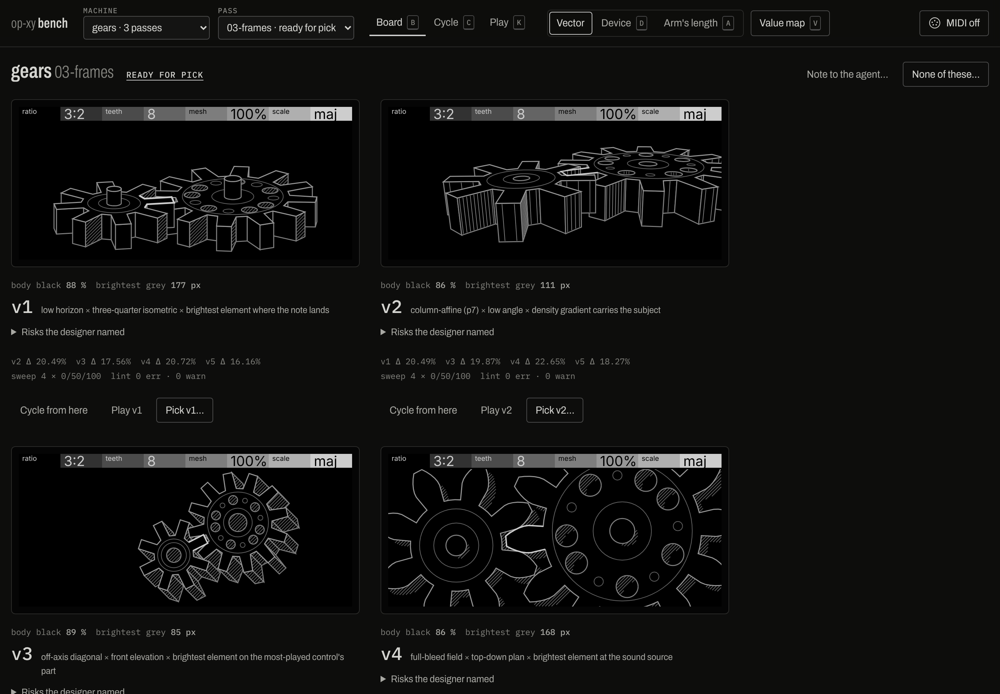
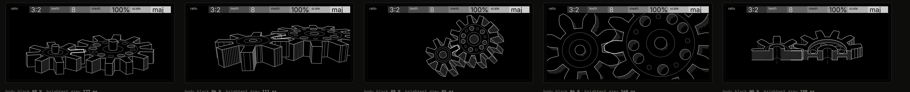
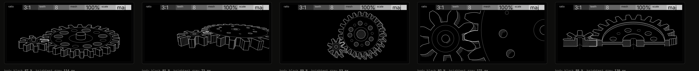
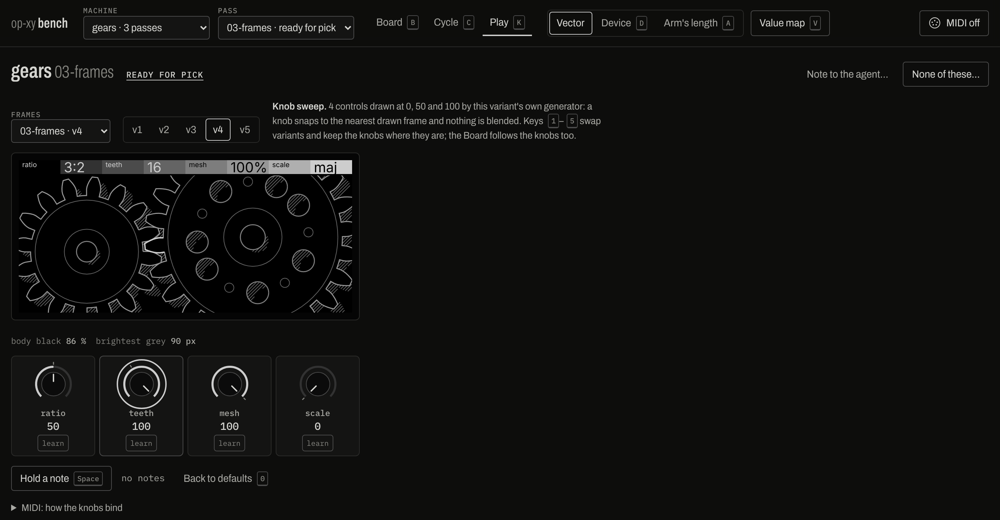
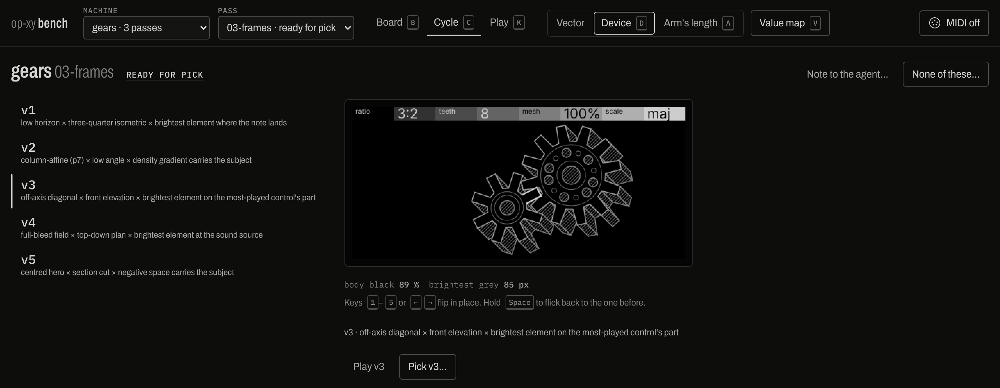
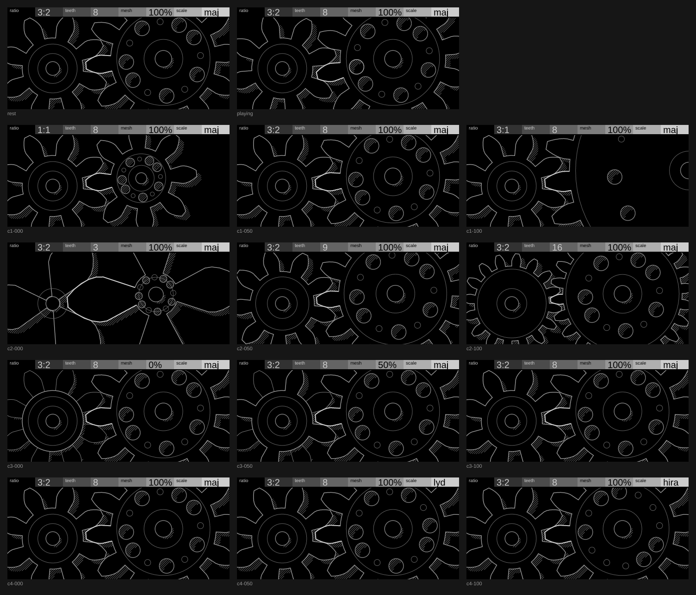
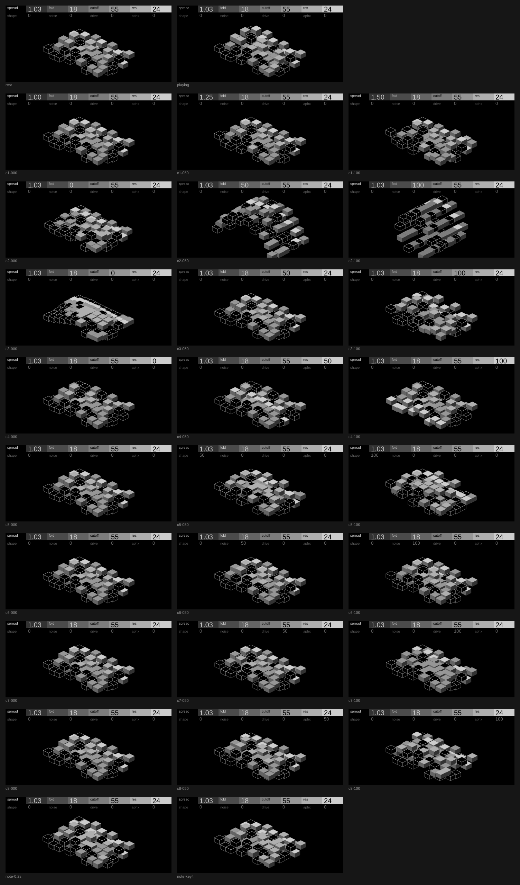
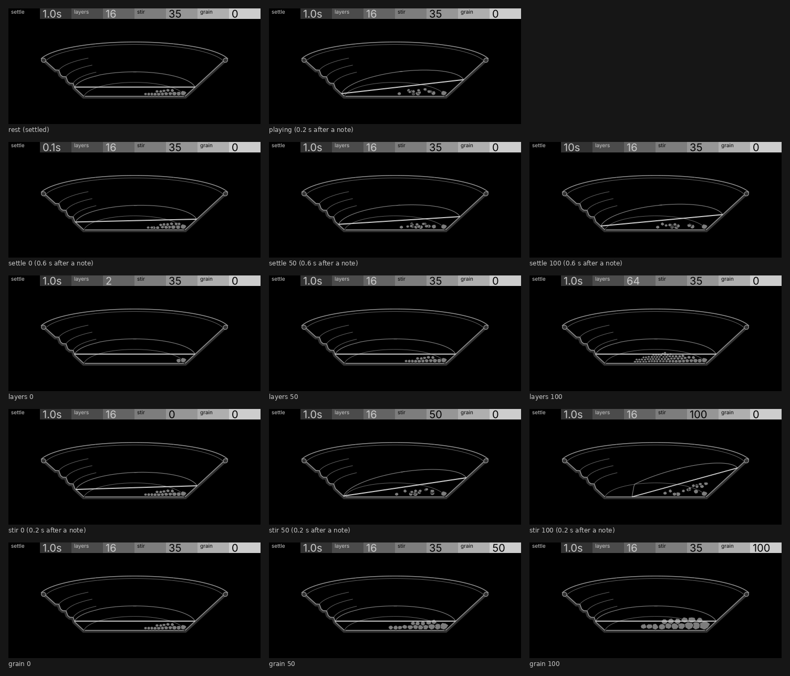
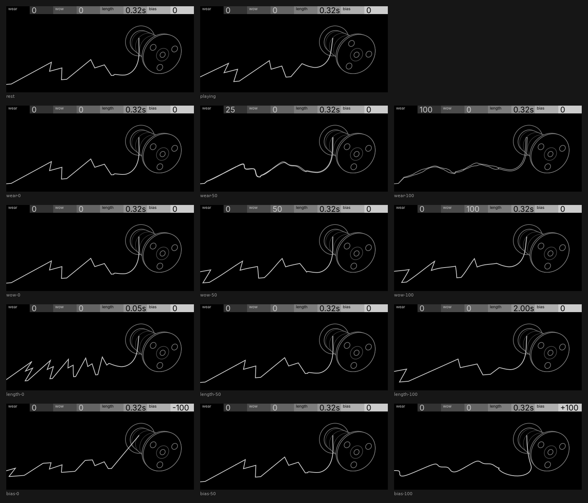
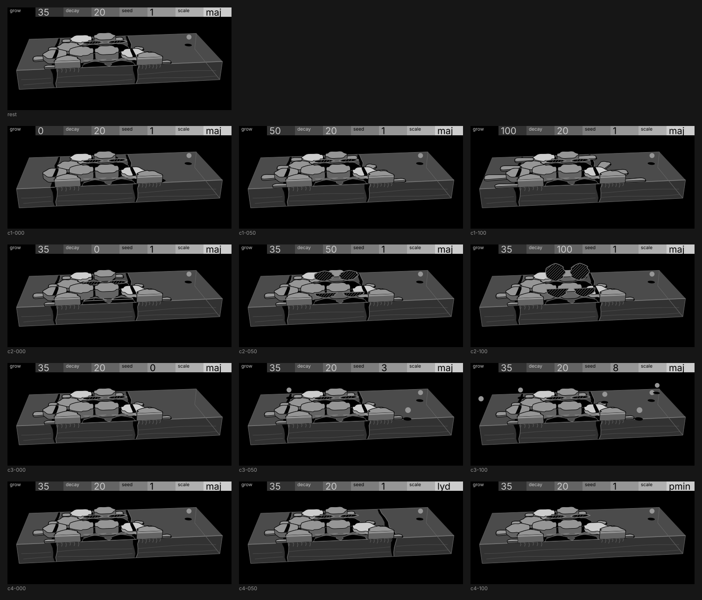

# operators

This project is a structured framework for designing graphics for Teenage Engineering devices. Protocols, patterns, constraints and tooling live here so that anyone can design a consistent experience every time.

Right now it holds one module: **`opxy/`**, the protocol for designing the screen a custom machine draws on the OP-XY through the [open-xy SDK](https://github.com/etcetc000/open-xy). More modules can sit beside it later (sequencing workflows, preset design, sound-design notes) without touching it.

It's also an **MCP server** (`mcp/`), so Claude Code, Claude Desktop, Codex, LM Studio and Ollama can run the protocol with the real tools: every generative design pass is five unique variants, and **training mode** (`training/`) is how the guidelines learn, through draft → audit → review → gate → a person's approval, with a separate agent at each stage.

## Set up the MCP server

The full walkthrough (install, each harness, every setting, the bench and MIDI) is in [`docs/setup.md`](docs/setup.md). The short version follows.

Everything runs on Python 3.10+ with no packages to install. Rendering frames to PNG, so agents can look at them and the uniqueness check can measure them, needs one renderer: either build the Rust one in `crates/opxy-raster` (`cargo build --release`; no system libraries, the same pixels everywhere) or install `rsvg-convert` (macOS `brew install librsvg`, Debian/Ubuntu `apt install librsvg2-bin`). Rust is optional; the tools use whichever they find.

Clone the repo first, then pick your client. Every setup command merges into your existing config (other servers stay put), saves the old file as `.bak`, and takes `--dry-run` if you want to see what it'll write first.

```sh
git clone https://github.com/thoughtgrain/operator-design.git
cd operator-design
```

**Claude Code.** Nothing to install for this repo. Open it in Claude Code and approve the `operator-design` server when it asks; `.mcp.json` registers it and `.claude/agents/` brings the designer, drafter, auditor and reviewer subagents. To use it from every project instead:

```sh
python3 mcp/setup.py claude-code --scope user
```

**Claude Desktop.** Writes the server into Desktop's config with the full path to your Python, since Desktop doesn't see your shell's `PATH`. Restart Desktop afterwards.

```sh
python3 mcp/setup.py claude-desktop
```

**Codex.** Adds the server to `~/.codex/config.toml` (or `--scope project` for `.codex/config.toml`, which only loads in trusted projects). The custom agents are already in `.codex/agents/`, and Codex reads `AGENTS.md` on its own.

```sh
python3 mcp/setup.py codex
```

**LM Studio.** Adds it to `~/.lmstudio/mcp.json` with the compact tool profile (16 tools, short descriptions) so it fits a small model's context, and points agent runs at LM Studio's local server. Use a model that supports tool calls.

```sh
python3 mcp/setup.py lmstudio --model qwen3-8b
```

**Ollama.** Ollama has no MCP client of its own, so it goes through [mcp-client-for-ollama](https://pypi.org/project/mcp-client-for-ollama/). Setup writes the server file and prints the command to start it:

```sh
python3 mcp/setup.py ollama --model qwen3:8b
pip install mcp-client-for-ollama
ollmcp -j ~/.config/ollmcp/mcp-servers/operator-design.json -m qwen3:8b
```

**Any other MCP client.** Print the generic stdio entry and paste it into the client's config:

```sh
python3 mcp/setup.py print
```

**Optional settings.** These flags work with any of the commands above:

- `--colour` lets that client design in colour. Grey is the default because it's the OP-XY's own look; colour is an override you set per client, here, and an agent can't switch it on. Red stays off-limits either way.
- `--pick-preview after-pick` saves tokens: the five variants of a pass come without knob sweeps, and the knobs (and MIDI) arrive with the picked variant's frames instead. The default, `sweep`, lets you play all five before you pick. `--sweep-steps 5` draws each control at five positions instead of three.
- `--shift-stack` shows Shift as open-xy's stacked header rows instead of swapping the header's four slots.
- `--sdk ../open-xy` points the server at a local checkout of [open-xy](https://github.com/etcetc000/open-xy), so it can run open-xy's own `sdk.py test` on a finished machine.

**Check it worked.** This lists what's in place for each client; a missing client is fine if you don't use it.

```sh
python3 mcp/setup.py check
```

Then try it: ask the agent to design a screen (the `design-screen` prompt in clients that show prompts) and it should start by reading the protocol and the machine's category. Environment settings, the full tool list and how design passes and training mode run are in [`mcp/README.md`](mcp/README.md).

## How to use it

Once the server's connected, talk to the agent in plain language. It reads the protocol, picks the right tools, and stops to ask whenever a decision is yours. These are the main things it's for.

### Design a screen

Ask for it by machine, and say what the sound does if the agent can't read the code:

> Design the screen for `toro`, a two-oscillator synth with a wavefolder. Controls come from its OP-1 plugin.

What happens, in order:

1. **Setup.** The agent makes `screens/<id>/` with a brief and asks which category the machine is (engine, drum, sampler, effect, player, sequencer, function) if it can't tell. The category decides which patterns it starts from.
2. **Definition and scores.** It builds or reviews `definition.json`, then scores how much each control changes the sound (1–5). It asks you to confirm the scores, because they size how far each control moves on screen.
3. **Subject pass.** You get **five** candidate subjects, each from a different pattern and drawing style. You pick one and say why; the agent never picks.
4. **Frames pass.** Five rest-frame variants of that subject, shown side by side at 1:1. You pick again, and it draws the full frame set from your pick.
5. **Checks.** Every frame is linted against the device rules, every control is checked for visible change against its score, and you get a contact sheet to look at. Anything that fails goes back a step instead of being waved through.
6. **Motion and an optional video.** After the motion spec, it asks whether you want a video preview, silent or with sound. If you say yes, the agent renders it itself. Any sound is **simulated**: the engine's code run on a computer, not a recording from an OP-XY, and the video says so.
7. **Review and handoff.** A review checklist with evidence, then `handoff.md` for whoever writes `display.cpp`. Anything only a real device can prove stays marked pending.

If a review sends something back, the fix is another pass of five, never a quick patch to one frame.

### Pick on the bench, and play the screen

> Open the bench for `beacon`.

The agent starts a local page and gives you its URL (or run `python3 opxy/tools/bench.py beacon` yourself). There you see the pass's five variants at 1:1, side by side or flipped in place, through a device-pixel or arm's-length lens if you want; you pick one, or turn the pass down, with your name and a reason, and the agent hears about it. In **Play**, the machine's controls are knobs: drag them, use the arrow keys, or plug in a MIDI controller (Chrome or Edge) and turn real ones, with notes from it holding the screen's note state. Machines with a `bench.py` draw every knob position live from their own generator. During a pass, each of the five variants comes with a short knob sweep, so a knob turned on your controller moves all five cards on the board at once and you choose with the interaction in hand, not just the still. If you'd rather save that work until after the pick, set `OPXY_PICK_PREVIEW=after-pick` (or ask for it on one pass); the knobs and MIDI then stay hidden until there are frames to move. The full tour is in [`mcp/README.md`](mcp/README.md#the-bench), and MIDI binding (auto-bind, learn, relative encoders, the OP-XY as its own controller) is in [`docs/setup.md`](docs/setup.md#5-midi).

#### What it looks like

The bench screenshots are all one real pass: `gears`, a player whose subject is two meshed spur wheels, on its five-variant frames pass with knob sweeps. Frames are at 1:1 (the screenshots are at 2× pixel density, so they stay sharp on a high-DPI screen).



**Board.** Five directions on one subject: low horizon, column-affine, off-axis diagonal, full-bleed plan, section cut. Under each card are its direction, how far it differs from each of the others (Δ, share of the body), its knob sweep, its lint count, and the risks its designer named. **Pick vN…** records your choice with your name and a reason; **None of these…** turns the pass down.




**One knob, five answers.** The row at rest, then after one turn of **Ratio** to 3:1. Every card follows the same knob, so a MIDI controller shows all five designs answering the same twist at once.



**Play.** The definition's controls as knobs (mouse, arrow keys or MIDI), a held note, and `1`–`5` to swap variants without losing the knob positions. Here v4 with **Teeth** at 16.



**Cycle, device lens.** One variant at a time in the same spot, rasterised at the panel's real resolution, which takes away a high-DPI screen's flattery.

#### Generated frames

Contact sheets the tools wrote (`python3 opxy/tools/contact_sheet.py <folder> --out sheet.svg --png`): rest, playing, and each control at 0, 50 and 100 with the others at default.



*`gears` v4: the sweep `design_pass_submit` drew from the variant's `bench.py` before the pick.*

| | |
| --- | --- |
|  |  |
| `toro`: the blocks drawing, eight controls across two header pages | `silt`: grains settling in a bowl |
|  |  |
| `spool`: a loop of tape read pass after pass as it wears | `lichen`: a colony spreading across a lattice of scale degrees |

### Audit a screen

> This is my screen for `theseus`, frames are in this folder. Does it meet the guidelines?

The agent asks whether it's your work and under what licence, runs every automated check that applies, writes a draft report where anything not checked says **not checked**, then does the by-eye checks. The verdict is meets, meets with notes, or not yet with the fixes in order. A passing screen that's yours to share can go into `library/`.

### Teach the guidelines something (training mode)

When a screen teaches something worth keeping (a new pattern, a pitfall, a category nothing fits), say so:

> The cable drawing on the patch-bay screen worked. Propose it as a new pattern.

The agent drafts a proposal, then hands it to a separate auditor and a separate reviewer, then runs an automated gate. Nothing changes in the docs until a person approves it from a terminal:

```sh
python3 mcp/train.py list --state awaiting_approval
python3 mcp/train.py show <id>                         # history, verdicts and the full diff
python3 mcp/train.py approve <id> --by "<your name>"
python3 mcp/train.py reject  <id> --by "<your name>" --reason "…"
```

After approving, commit the changed docs together with the proposal folder. The whole process is in [`training/README.md`](training/README.md).

### Look something up

> What are the perceptibility floors? Which patterns fit a drum machine? Show me the theseus library entry.

These are answered straight from the docs and the library, with nothing written.

### With a local model

Small local models do best with the compact profile that the LM Studio and Ollama setups turn on. They can also run the auditor and reviewer for training mode themselves: ask the agent to advance a proposal "with run on", and the server sends each stage to the model you set up. Approval still stays with a person.

## Layout

```
operators/
├── README.md                      ← you are here
├── AGENTS.md                      ← agent entry point: what to load for which task
├── CLAUDE.md                      ← imports AGENTS.md for Claude Code
├── .mcp.json                      ← registers the MCP server for Claude Code
├── mcp/                           ← the MCP server, client setup and the training CLI
├── training/                      ← training mode: process, agent roles, proposals, changelog
├── .claude/agents/, .codex/agents/ ← designer, drafter, auditor, reviewer (generated from training/agents/)
├── .claude/skills/opxy-screen/    ← skill that runs the screen protocol end to end
├── .claude/skills/opxy-audit/     ← skill that audits a finished screen and adds passing ones to the library
├── .claude/skills/opxy-train/     ← skill that runs training mode
├── opxy/
│   ├── README.md                  ← module index and reading order
│   ├── categories.md              ← engine, drum, sampler, effect, player, sequencer, function
│   ├── catalog.json               ← categories, patterns by category, library, five-iteration settings
│   ├── protocol.md                ← the phases, gates and outputs
│   ├── patterns.md                ← composition patterns and the visual-channel table
│   ├── constraints.md             ← hard limits distilled from open-xy, with sources
│   ├── craft.md                   ← one drawing language, line weights, the side-by-side review
│   ├── accessibility.md           ← legibility, contrast and motion on a 480 × 220 grey screen
│   ├── audit.md                   ← how a finished screen is judged and enters the library
│   ├── tokens.json                ← machine-readable numbers the tools and agents use
│   ├── templates/                 ← brief and starter frame
│   ├── tools/                     ← frame linter and contact-sheet builder (stdlib Python)
│   └── reference/                 ← annotated reference screens
├── crates/opxy-raster/            ← optional Rust renderer for frames (resvg); the tools fall back to rsvg-convert
├── screens/                       ← work in progress, one folder per machine
└── library/                       ← audited screens that met the guidelines, kept as references
```

## How it relates to open-xy

open-xy owns the truth about the device: the display ABI, the UX conventions machines are reviewed against, and `sdk.py test`. This repo doesn't fork those rules. `opxy/constraints.md` restates the numbers designs are checked against and links every one back to its source, so when the SDK moves, one file changes.

What open-xy doesn't cover is the design process itself: going from "here's a sound and its parameters" to a screen where every control reads, inside the node budget, before anyone writes `display.cpp`. That's what this repo is for.

## Adding a module

1. Make a top-level folder named for the domain (`opxy-presets/`, `sequencing/`).
2. Give it a `README.md` with its reading order, and keep hard limits in one `constraints.md` with sources.
3. Add a routing line to `AGENTS.md` so agents know when to load it.
4. If an agent should run it end to end, add a skill under `.claude/skills/`.
5. If the MCP server should expose it, add its docs to `mcp/opxy_mcp/knowledge.py` → `DOCS` and its tools to `tools.py`.

Not affiliated with Teenage Engineering or the open-xy project. OP-XY is a Teenage Engineering trademark. Nothing in here copies stock artwork.
