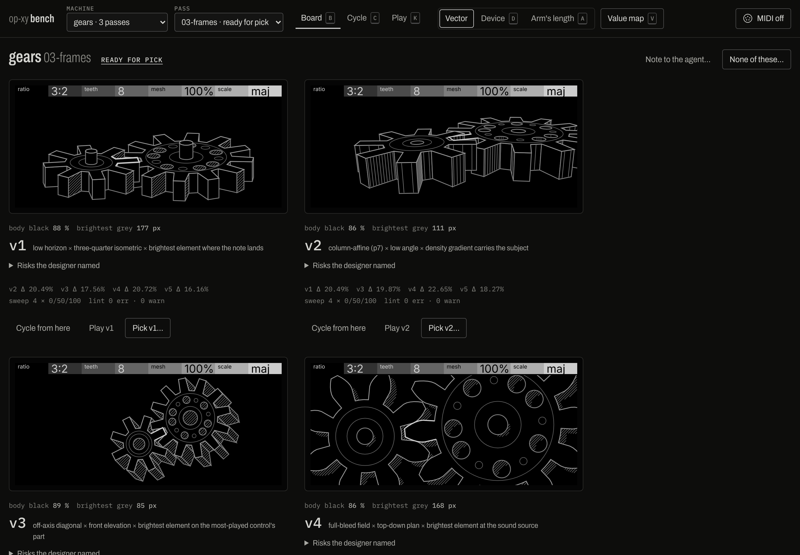
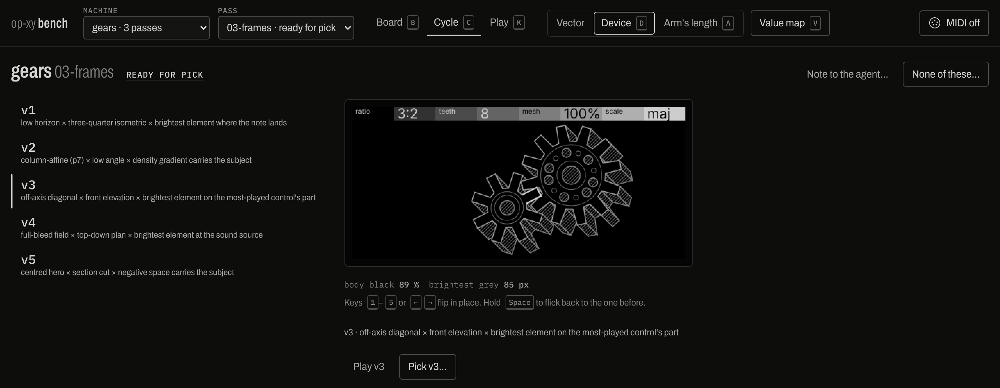
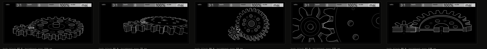
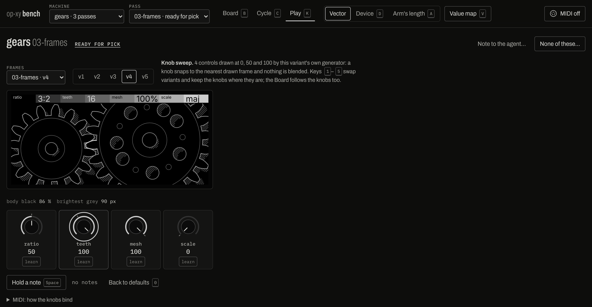

# Setup: install, harness, configuration, bench and MIDI

This is the whole setup in one place, in the order I'd do it on a fresh machine. The short version lives in the [README](../README.md#set-up-the-mcp-server); the tool-by-tool reference is in [`mcp/README.md`](../mcp/README.md).



## 1. Install

You need **Python 3.10 or newer**, and that's it for the core. The MCP server, the checks in `opxy/tools/` and the bench are all standard-library Python: no `pip install`, no virtualenv, no build step. I kept it that way on purpose. These tools get run by agents in whatever harness someone has, and every dependency is one more thing that can be missing.

```sh
git clone https://github.com/thoughtgrain/operator-design.git
cd operator-design
python3 mcp/server.py --check     # prints the tool count, the renderer it found, and the policies in force
```

### A renderer (recommended)

Agents judge frames by looking at them at 1:1, and the uniqueness check measures pixels. Both need an SVG renderer. The tools look for one in this order (`opxy/tools/raster.py`):

1. **`opxy-raster`**, the Rust renderer in `crates/opxy-raster`. It's resvg underneath, so there are no system libraries and every platform gets the same pixels. It also has a `--luma` mode that hands back brightness directly, which makes the perceptibility checks about three times faster.

   ```sh
   # install Rust once: https://rustup.rs
   cargo build --release            # → target/release/opxy-raster, found automatically
   ```

   To use a copy somewhere else, set `OPXY_RASTER=/path/to/opxy-raster`.
2. **`rsvg-convert`**: `brew install librsvg` on macOS, `apt install librsvg2-bin` on Debian or Ubuntu.

Without either, everything still runs, but `design_pass_submit` records `pixel check skipped` instead of measuring, and `render_frame` can't give an agent a picture to look at.

## 2. Hook it into your harness

`mcp/setup.py` writes the server into each client's config. It merges with what's already there, keeps the old file as `.bak`, and takes `--dry-run` so you can read what it would write first.

| Harness | Command | Notes |
| --- | --- | --- |
| Claude Code (this repo) | nothing | `.mcp.json` registers the server; approve it when asked. `.claude/agents/` brings the designer, drafter, auditor and reviewer subagents |
| Claude Code (every project) | `python3 mcp/setup.py claude-code --scope user` | |
| Claude Desktop | `python3 mcp/setup.py claude-desktop` | writes your Python's absolute path, since Desktop doesn't see your shell's `PATH`; restart Desktop |
| Codex | `python3 mcp/setup.py codex` (or `--scope project`) | agents are in `.codex/agents/`; Codex reads `AGENTS.md` on its own |
| LM Studio | `python3 mcp/setup.py lmstudio --model qwen3-8b` | compact profile (16 tools) so it fits a small context; `run: true` agents use LM Studio's server |
| Ollama | `python3 mcp/setup.py ollama --model qwen3:8b`, then `pip install mcp-client-for-ollama` and `ollmcp -j ~/.config/ollmcp/mcp-servers/operator-design.json -m qwen3:8b` | Ollama has no MCP client, so `ollmcp` bridges it |
| Anything else | `python3 mcp/setup.py print` | the generic stdio entry (`command`, `args`, `env`) to paste in |

`python3 mcp/setup.py check` shows what's in place for every client. A missing client is fine if you don't use it.

**Why the subagents matter.** Every design pass is five variants from five directions. In Claude Code and Codex those run as five parallel `opxy-designer` agents, each writing only into its own `v<N>/` folder. That keeps them from drifting toward each other, which a single agent drawing all five tends to do. Other harnesses can run the five briefs one after another, or with `run: true` on an OpenAI-compatible endpoint (`--endpoint`, `--model`).

## 3. Configuration

Everything below is an environment variable in the server's `env` block, and each has a setup flag that writes it. These are set by **the person, per harness**, in that config file. Some of them (colour, the Shift header) change what the OP-XY looks like, so a conversation can't turn them on. An agent asking for colour gets told where the setting lives, not a yes.

| Variable | Setup flag | Default | What it does |
| --- | --- | --- | --- |
| `OPXY_PICK_PREVIEW` | `--pick-preview sweep\|after-pick` | `sweep` | Knob sweeps before the pick. With `sweep`, each of a pass's five variants ships a `bench.py`, and submit draws it into a short run of frames you can play on the bench. `after-pick` skips that work on the four variants you won't pick (fewer tokens, faster passes); the knobs arrive with the picked variant's frame set instead |
| `OPXY_PICK_PREVIEW_STEPS` | `--sweep-steps 3\|5` | `3` | Frames per control in a sweep: 0/50/100, or 0/25/50/75/100 when a control's middle matters |
| `OPXY_COLOUR` | `--colour` | off | Allows colour in this harness. Grey is the OP-XY's own look; red is refused either way, and a colour machine also ships a designed grayscale version |
| `OPXY_SHIFT_HEADER` | `--shift-stack` | `replace` | `stack` shows Shift as open-xy's stacked header rows. By default Shift swaps the header's four slots for the Shift controls, the OP-XY's way |
| `OPXY_PROFILE` | `--profile full\|compact` | `full` | `compact` cuts the list to 16 tools with short descriptions, for small local models. The bench tools are only in `full` |
| `OPXY_WORKSPACE` | | this repo | where `screens/` lives, if it's a machine's own checkout |
| `OPXY_AGENT_ENDPOINT`, `OPXY_AGENT_MODEL`, `OPXY_AGENT_API_KEY`, `OPXY_AGENT_TIMEOUT` | `--endpoint`, `--model` | | where `run: true` sends designer briefs |
| `OPXY_APPROVERS` | `--approver` | unset | names allowed to approve training proposals over MCP; unset means approval only happens in a terminal |
| `OPXY_SDK` | `--sdk ../open-xy` | unset | a local open-xy checkout, so `sdk_test` can run open-xy's own tests |
| `OPXY_RASTER` | | auto | path to a renderer, if it isn't on `PATH` or in `target/release/` |

The pick preview is the one setting a conversation *can* change, and only for one pass: "skip the knob previews on this one" becomes `design_pass_start(preview="after-pick")`, and `pass.json` records it. It's a cost decision, not a look decision, so it doesn't need the same lock as colour.

For example, a Claude Desktop setup on a tight token budget, with knob sweeps deferred to after the pick and colour allowed:

```sh
python3 mcp/setup.py claude-desktop --pick-preview after-pick --colour
```

## 4. The bench

The bench is a local page for the moment of choosing. Ask the agent to open it (`bench_open`), or run it yourself:

```sh
python3 opxy/tools/bench.py                    # every machine; choose in the page
python3 opxy/tools/bench.py gears --pass 03-frames
```

It listens on `127.0.0.1:8470`, or the next free port, and prints a URL with a session token in it. Open that URL, not a bare `localhost:8470`: the token is how the page gets its cookie. Every POST must come from the same origin, and frames are served only from `screens/` with a policy that stops SVG scripts. `--host 0.0.0.0` would put it on your network; don't, unless you mean to.

What's on it:

- **Board**: the five variants side by side, at 480 × 220 CSS pixels and never scaled. Each card shows its direction, the subject, what each control does, the designer's named risks, the pairwise uniqueness results and its lint count. **Pick vN…** records your choice with your name and reason, through the same gate an agent's `design_pass_select` goes through. **None of these…** turns the pass down, and the next pass takes your reason as its focus.
- **Cycle**: one variant at a time in the same spot. `1`–`5` or the arrows flip; hold `Space` to flick back to the one before. Flipping in place shows differences that side by side hides.
- **Play**: the machine's controls as knobs, plus a held note.
- **Lenses**, on every frame: *vector* (the browser's SVG), *device* (`D`, rasterised at 480 × 220 and shown pixel for pixel), *arm's length* (`A`, downsampled and softened), and *value map* (`V`, keeps only the brightest grey, since there should be one brightest element). A meter under each frame gives body black against the 40% floor.



### Knobs drive every view

There's one knob state for the whole page. Turn a knob, on screen or on a MIDI controller, and the Board's five cards, the Cycle stage and Play all show each variant's frame for that position. That's the point of the sweep: you see five designs answer the same twist at once, which a still can't show. In Play, `1`–`5` swap variants and keep the knobs where they are, and `0` puts every knob back to its default.





What a knob shows depends on what exists:

| Source | What a knob does |
| --- | --- |
| `screens/<id>/bench.py` (machine-level) | every position drawn live by the machine's own generator, eased like the device (settles in 0.15–0.2 s) |
| a swept pass variant, or `frames/` | snaps to the nearest drawn keyframe. Nothing is blended, because a crossfade would show a grey ghost no frame contains; the knob shows a tick at the frame it's showing |
| none of these | **no Play tab and no MIDI button.** A knob that turns and changes nothing reads as broken, so it isn't offered. The pass line says when the knobs will arrive (after submit, or after the pick with `after-pick`) |

## 5. MIDI

The bench reads MIDI input through **Web MIDI**. It sends nothing back.

**Browsers.** Chrome and Edge have Web MIDI; Safari doesn't, and neither does Firefox without an add-on. On `127.0.0.1` the page counts as a secure context, so Chrome doesn't need https. Without MIDI, the on-screen knobs, arrow keys and `Space` for a note still work in any browser.

**Connect.** Press **MIDI** at the top right (it's only there once there's something to move) and allow access. The button shows how many inputs it sees and blinks on activity. Controllers plugged in later appear without a reload.

**Binding knobs to controls:**

1. **Auto-bind.** Turn knobs on your controller: the first CC each one sends binds it to the next unbound control, in the definition's order. A toast says which (`CC 21 → Ratio`).
2. **Learn.** To choose, press **learn** under a control, then turn the knob you want. It takes over, and any old binding of that knob or that control is dropped.
3. **Unbind.** Click the `CC21 ×` chip under a control.
4. **Relative encoders.** Endless encoders that send steps instead of positions want **rel** switched on for their binding. It reads the common two's-complement form: 1–63 up, 65–127 down.

Bindings are saved per machine in that browser's local storage, so they survive reloads and restarts but not a different browser.

**Notes.** Any note-on from any channel holds the screen's note state (the `playing` frame, or `notes = 1` for a live generator). Note-off releases it, and *all notes off* or *all sound off* (CC 123 or 120) clears every held note. Leaving the window releases keyboard and button holds, so nothing gets stuck.

**The OP-XY as the controller.** Over USB, the OP-XY can drive its own preview if its encoders send CC on your setup. They're endless, so switch **rel** on if the knob jumps instead of turning. This is still a preview: nothing on the bench ticks a device check. Those stay pending until someone photographs the real screen.

## 6. Check it worked

```sh
python3 mcp/setup.py check          # what each client has
python3 mcp/server.py --check       # tools, renderer, colour / Shift / preview policies
python3 mcp/tests/test_server.py    # the suite: protocol, checks, passes, sweeps, bench, training
cargo test                          # the renderer's own tests, if you built it
```

Then ask your agent to design a screen. It should start by reading the protocol and asking for the machine's category, and when the five variants are drawn it should offer you the bench.
