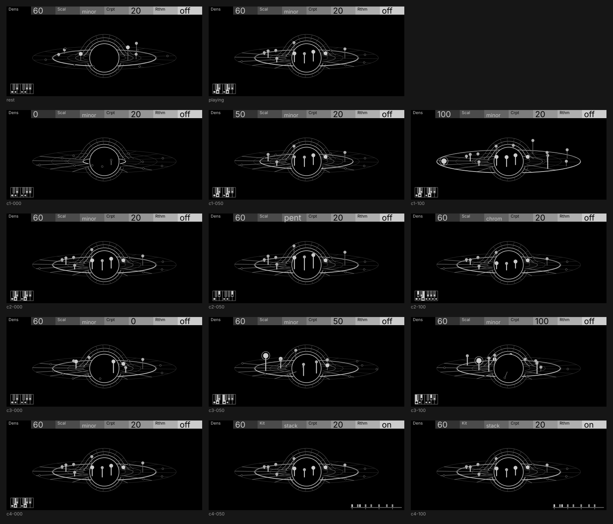

# Meikyu (capture)

| | |
| --- | --- |
| Machine | `meikyu` · note player · [labyrinth](https://github.com/thoughtgrain/labyrinth) (OP-XY port of the OP-1 sequencer) |
| Author | Brian Hinton (thoughtgrain) · MIT |
| Pattern | P13 Capture (from `opxy/patterns.md`) |
| Audit | **not yet** on Drum's two-state half-step floor and the turning disc's redraw cost; all else passes or is device pending · 2026-11-01 · tokens `pull/260` · [audit.md](audit.md). Kept as a pattern reference |
| Device | **needs the player page to bind nodes**; device pending |
| Source | `screens/meikyu/concepts/blackhole_capture.py` (also `blackhole3.py` for the lensed-disc shape, `blackhole_moons.py` for the kit sound); `python3 blackhole_capture.py <dir> melody\|drum\|frames` |
| Video | [capture-melody.mp4](capture-melody.mp4), [capture-drum.mp4](capture-drum.mp4): the real player logic (a port of `press()`) with a stand-in voice and a synthesized kit |

## The screen

A black hole in wireframe: the lensed disc of the reference image (an arch over the hole, a ring under it, a flat disc crossing in front) drawn as thin rails, ribs, rings and one spoke per step. The hole isn't decoration: it does the player's job. A step plays when its weight is under Dens, and a black hole captures what comes inside a radius, so each step is a body at a distance set by its weight and Dens is the capture ring. What's inside plays.

## Controls

| control | score | channel | what the player sees |
| --- | --- | --- | --- |
| Dens | 5 | position, height | the capture ring widens; bodies it reaches rise on stems to their pitch, the rest lie flat and hollow; an inner ring at Dens/4 marks accents |
| Scal | 3 | position, height | a one-octave keyboard in the lower left shows the scale's shape as dots, drawn from C (C's dot bigger); each note's degree lights its key as it sounds; the stems move to the new pitches |
| Crpt | 3 | position | re-rolled bodies are thrown along their spoke to their new distance, with a streak |
| Rthm (now Drum) | 5 | position, shape, height | the scale keyboard gives way to the kit's pattern in the lower right: a spacing ruler with each pad a tick at its interval, repeats stacked (so `roll` is one tall column), the struck pad's tick lit; stems become pad lanes; the kick thumps the hole's edge, the snare the ring under it |
| Kit (Scal in drum mode) | — | shape | four pad patterns named for what they are: `stack` (meikyu's spread), `roll` (every pad on one key: a roll on one drum), `fill` (pairs over four neighbouring keys: a fill), `clust` (semitone pairs) |
| a press | — | weight, flash | the phrase's 8 spokes and stems thicken and brighten; each body flashes as its step sounds; the wire brightens by velocity |

## What makes it work

- **The metaphor does the work.** Find the player's own rule (weight under Dens) and a physical thing with the same shape (inside the capture radius). Then the picture explains the player without a legend.
- **Keep the middle clear.** Nothing near is drawn across the hole except the bodies; the wire is thin and dim, so the bodies, the capture ring and the hole's edge lead.
- **Turn slowly, and only while it plays.** The disc turns a full circle a minute while notes play and eases to a stop with the music. Steps keep their slots on it; the playhead is the order things light in. A disc spinning at the step rate was far too fast.
- **Controls without a twin go to the corners.** Scal and Kit don't map onto a black hole, so they get a plain keyboard of their own, drawn from C so each scale is a recognisable shape of dots; the kit gets a spacing ruler, so each kit is a recognisable spacing ([capture-keys.png](capture-keys.png): the four scales, then the four kits).

## Notes

- Showing the scale as arch cells and the kit as pads in the under-ring was tried and rejected on looks.
- The turning disc is over the per-frame redraw budget on a device (see the audit).
- Drum's half-step floor: a protocol question for two-state switches (see the audit).
- The wire is open strokes; a device build redraws it as thin closed ribbons.
- Needs labyrinth changes: player page bound nodes, short Scal labels, `Rthm`, Kit as Scal in drum mode with the four pad patterns and their names.
- The demo's drum sound is a stand-in that keeps one key one drum; on a device the kit loaded on the drum track decides.
- Device checks pending.
