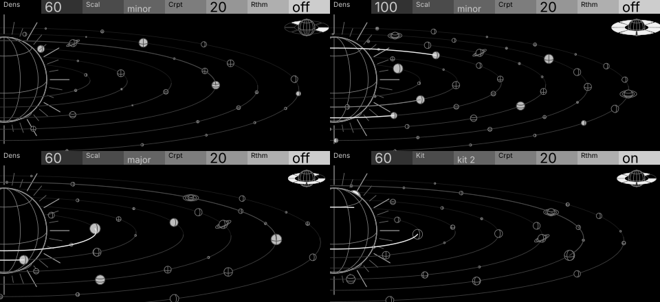

# Meikyu (orrery)

| | |
| --- | --- |
| Machine | `meikyu` · note player · [labyrinth](https://github.com/thoughtgrain/labyrinth) (OP-XY port of the OP-1 sequencer) |
| Author | Brian Hinton (thoughtgrain) · MIT |
| Pattern | P12 Orrery (from `opxy/patterns.md`) |
| Audit | **not audited**: kept as a pattern reference |
| Device | needs to run where it can bind nodes: the stock player page is 24 on/off dots, but a track-control synth on aux track 12 (open-xy SDK 1.9) draws its own page; device pending |
| Source | `screens/meikyu/concepts/orrery3.py` (scene, camera, layout), `orrery4.py` (page, motion, demo), `planet_kinds.py`; render with `MEIKYU_VARIANT=no-belt python3 orrery4.py <tmpdir>` |
| Video | [meikyu-orrery.mp4](meikyu-orrery.mp4): the real player logic (a port of `press()`) with a stand-in voice |

## The screen

A solar system in 3D: the corona sun half off the left edge, six concentric orbits round it in one plane, and up to
100 planets of four subtle kinds (wireframe, smooth, banded, rocky), six of them with tilted rings. Sixteen of the
planets are the register's steps; the rest join as Dens rises. It's built as a scene and projected through one
camera, so orbits stay evenly spaced, wrap the sun (near halves in front of it, far halves behind), and bodies are
ordered by their distance to the camera.

## Controls

| control | what the player sees |
| --- | --- |
| Dens | how many planets are out: about 4 at 0, 60 at the default 60, all 100 at 100; a step planet fills while its step plays |
| Crpt | steps rewritten between phrases, so fills (and some planets) change phrase to phrase |
| Scal | how far the orbits spread, pentatonic tightest to chromatic widest; in rhythm mode it reads Kit and picks the pad set |
| Rthm (was Drum) | struck planets jump up and fall back |
| a press | links run along an orbit from each sounding planet to the next on that orbit (the way the planets travel); a move to the next orbit flashes that planet instead of drawing a line |

## What makes it work

- **Model, then project.** The sun is a sphere, the orbits evenly spaced circles round it, one camera; spacing, curvature, size and occlusion all fall out of the model (`opxy/craft.md`, Think in 3D).
- **Links follow the path.** A link is the orbit itself between two planets, same radius and plane, drawn in the direction of travel. It connects fast (0.1 s) and lets go slowly (1.2 s in three greys); four show at most.
- **No touching, in two layers.** The step planets' starting angles are searched so they never touch; extras step out of view while they would, and grow back in.
- **Variety without noise.** Four kinds share one line weight and fill; only the surface differs. Smooth and banded planets need no spin variants, which is what lets 100 planets fit.
- **A counted budget.** `device_parts()` tallies the device parts on every build: 218 of 256 (4 links, 8 phrase-ring segments, look variants per planet, 4 ring halves per ringed planet).

## Open

- The player page ABI has to grow bound nodes (position, uniform scale, palette) and four mutable outlines for this to run on the device.
- Rthm's kits (Scal picking the pad set) need the matching change in labyrinth's `player.cpp`; the header label lives in its `definition.json`.
- Not audited; perceptibility and device checks pending.
