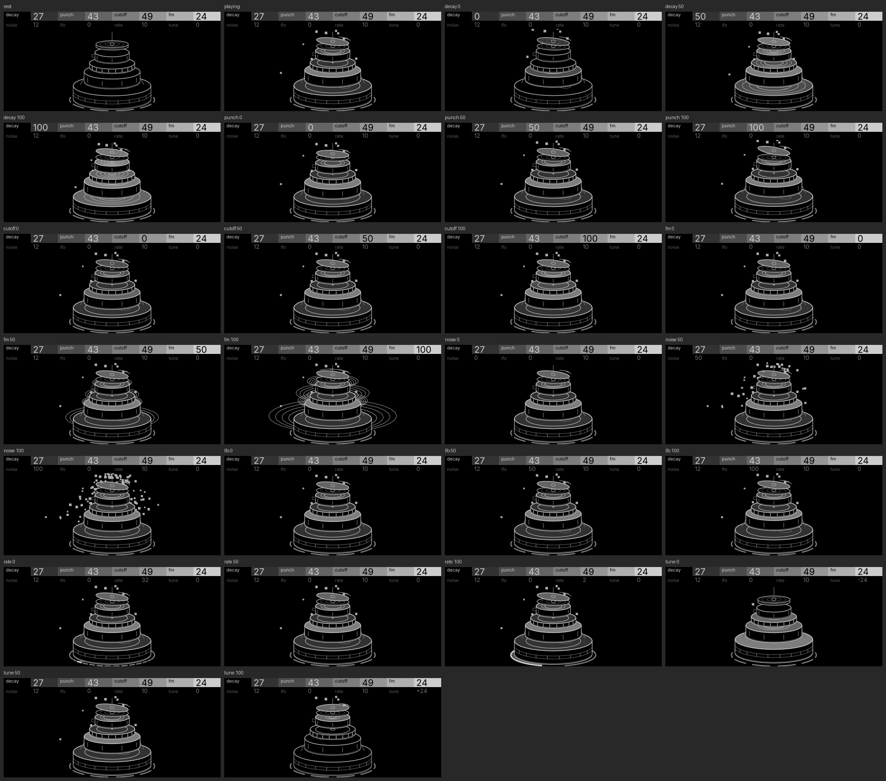

# Theseus (drum tower)

| | |
| --- | --- |
| Machine | `theseus` · synth (drum voice) · [labyrinth](https://github.com/thoughtgrain/labyrinth) (OP-XY port of the OP-1 plugin) |
| Author | Brian Hinton (thoughtgrain) · MIT |
| Pattern | P11 Instrument stack (from `opxy/patterns.md`) |
| Audit | **meets, with notes** · 2026-10-31 · tokens `source.ref` pull/260 · [audit.md](audit.md) |
| Device | **device pending** |
| Source | `screens/theseus/concepts/d4_video.py` (drawing, motion, score), `screens/theseus/audio/` (sound from the real engine) |
| Video | [theseus-tower.mp4](theseus-tower.mp4), with theseus's own engine as the soundtrack |

## The screen

Theseus is one voice that plays the whole kit: the note picks the drum. So the screen is the kit, stacked into a tower from kick at the base to hi-hat on top, each tier drawn as the drum it plays. It's a line drawing: black shapes with grey outlines, so the drums stay separate where they overlap. Only the drum that's hit moves (upward) and fills with light, so the eye always lands on what just played.

## Controls

| control | score | channel | what the player sees |
| --- | --- | --- | --- |
| decay | 4 | count, time | more rings across the struck head, lasting longer |
| punch | 4 | position | how high the struck drum jumps; how far the hats rock |
| cutoff | 4 | shade | how brightly the struck head fills |
| fm | 4 | shape | inharmonic ghost hoops thrown outward from the struck head (none at the default) |
| noise | 3 | count | sparks spraying off the struck head, more on the high drums |
| lfo | 3 | position | some hits jump higher than others, following the hit LFO |
| rate | 1 | count | the floor is the LFO's clock: one dash per hit of the cycle (32 .. 2), the current one lit |
| tune | 3 | position | which tier a note lands on |
| a note | — | position, shade | the struck drum jumps and lights; a hat hit lifts the top cymbal open and rocks both, alternating sides |

## What makes it work

- **The subject is the instrument.** For a drum machine, drums beat abstraction: the player already knows which part is which. Each tier carries the drum's own details (the kick's wrap stripe and beater patch, the floor tom's legs, the snare's wires and strainer, the rack tom's mount, the hi-hat's rod), so nothing needs a label.
- **Line drawing, light on use.** Outlines keep five overlapping drums legible; filling only the played drum makes the hit the brightest thing on screen.
- **Only what plays moves, and only upward.** One drum at a time moves, which reads clearly and keeps the redraw cost to that tier's nodes.
- **Floors can be controls.** The floor under the kick is in the same perspective as the heads, and doubles as the LFO's clock.

## Notes

- Rate is scored 1 because it is silent at the default LFO depth (0); with LFO up it reads clearly on the floor clock and in how hits vary.
- Device pending; and it hasn't been fitted to the node budget yet (see the audit).
