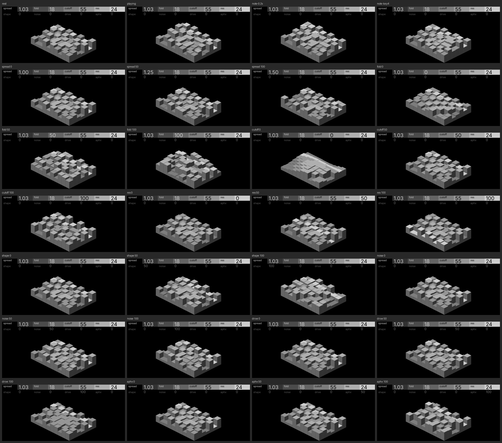

# Toro (stacked blocks)

| | |
| --- | --- |
| Machine | `toro` · synth · [labyrinth](https://github.com/thoughtgrain/labyrinth) (OP-XY port of the OP-1 plugin) |
| Author | Brian Hinton (thoughtgrain) · MIT |
| Pattern | P10 Voice field (from `opxy/patterns.md`) |
| Audit | **meets, with notes** · 2026-10-31 · tokens `source.ref` pull/260 · [audit.md](audit.md) |
| Device | **device pending** |
| Source | `screens/toro/gen_blocks.py` (frames, fragment, prototype); `screens/toro/blocks/` |

## The screen

An isometric field of seventy grey columns whose heights are a small model of toro's voice: two oscillators at the spread ratio, a folder, a filter's fine detail, a soft clip, noise and per-key drift. Turning a knob reshapes the field the way it reshapes the sound, and every note rolls the field forward and rings a ripple out from where the key lands.

## Controls

| control | score | channel | what the player sees |
| --- | --- | --- | --- |
| spread | 4 | shape (heights) | a second wave beats against the first |
| fold | 5 | shape | ridges fold back into terraces |
| cutoff | 5 | shape | broad waves at 0, fine ripple on top at 100 |
| res | 3 | shade + position | one row of tops lights up, front to back |
| shape | 3 | shape | ridges go from a sharp edge to symmetric |
| noise | 2 | shape | jitter in every column |
| drive | 3 | shape | the tallest columns clip to a plateau |
| aphx | 2 | shape | each column drifts its own amount, per key |

## What makes it work

- **The model is the drawing.** Heights come from the same signal path the sound does, so the mapping explains itself and no control needs a legend.
- **Pillars and skirts.** Each column is three nodes (top, left, right). The faces are fixed-length pillars that only ever translate. Drawing back to front hides their overhang, and two black skirts hide the front row's. There are no mutable outlines and no static art, so the whole screen can move.
- **Whole-pixel heights.** Snapping heights keeps edges crisp and means a column only redraws when it actually moves.

## Notes

- Over the redraw guideline by request; see the audit.
- Device pending.
