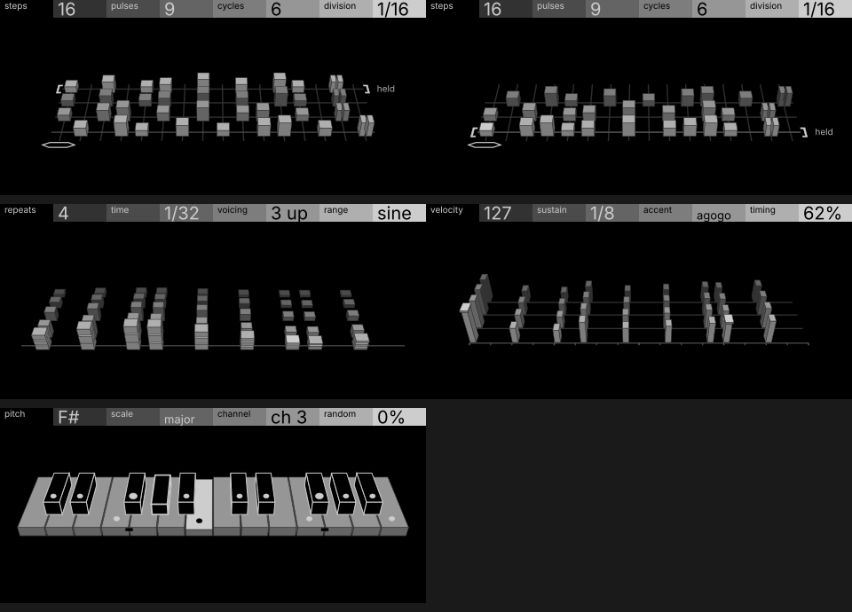

# Torso and Ariadne (loom pages, drafts)

| | |
| --- | --- |
| Machines | `torso` · a four-page sequencer engine, after the T-1's controls · `ariadne` · a function track (its keys are functions acting on a target track) · both for [labyrinth](https://github.com/thoughtgrain/labyrinth), SDK side in progress |
| Author | Brian Hinton (thoughtgrain) · MIT |
| Pattern | P14 Loom (from `opxy/patterns.md`) |
| Audit | **not audited**: drafts, kept as a pattern reference. No perceptibility or budget run yet |
| Device | **device pending**; node and outline counts per page still to fit (see Open) |
| Source | `screens/torso/clean.py` (M1), `screens/torso/round3.py` (M2 echo field, M3 lanes, M4 keyboard), `screens/torso/anim.py` (the demo); `screens/ariadne/concepts/loom.py`. Spec and page map: `screens/torso/map.md` |
| Video | [torso-pages.mp4](torso-pages.mp4): one pattern playing through M1 → M4 with knobs turned on each page, the notes as sound. [ariadne-loom.mp4](ariadne-loom.mp4): the loom on its own, with generated and locked steps, p-locks, ratchet, thin and a target switch |

## The screens

A sequence drawn as cloth. Steps are warp threads, each pass or cycle weaves a row, and notes are slabs raised on the threads. Everything is modelled in 3D and projected through one camera, so rows recede, slabs hide what's behind them, and age reads as distance and a darker grey. Each page is the stock header plus one drawing. The drawing represents the four parameters, but it isn't the interface: no strips of cells, badges or key grids at rest.

## Pages

| page | knobs | what the player sees |
| --- | --- | --- |
| M1 sequencer | steps · pulses · cycles · division | the loom: thread count, slabs on the front row (Euclidean), rows of cycles behind (four at most), thread spacing. A manual pulse has a rim, a retrigger is a split slab, the shuttle sits under the step playing. A held cycle sits on the back row in brackets with the word `held`, and slides to the front when recalled |
| M2 repeats | repeats · time · voicing · range | an echo field: across is the bar (heights follow the phrase), back is each pulse's repeats as lower, darker rows spaced by time and pace, up is the chord's notes as layers |
| M3 groove | velocity · sustain · accent · timing | the last four bars as lanes, newest in front: height is velocity, length along the lane is sustain, swing slides the off-beats off the grid ticks, accents get a cap, an uncertain pulse is hollow |
| M4 tonal | pitch · scale · channel · random | two octaves of keys in depth, black keys black in white wire: the scale's notes as dots on the key tops, the root's dot bigger with a mark on its front face, a played key pressed and lit, random jitters the dots. Channel is header only (routing, not sound) |
| Ariadne | targ · amt · rate · hold | the loom on the target track: locked steps are solid slabs that repeat row after row, generated steps are wireframe and change each pass, p-locks are pins with a bead per locked parameter, ratchet splits a slab, thin leaves a footprint |

## What makes it work

- **One language across pages.** Slabs, threads, the same camera and greys on every page, so the four pages read as one instrument. Only M4 keeps an interface, because choosing notes is the interaction.
- **Rows are time.** The loom (cycles), the echo field (repeats) and the lanes (bars) all use depth for "earlier", so the player learns one reading.
- **Hold, don't scroll away.** A cycle the player likes is kept on the back row in brackets and can be brought back; the screen shows it's there.
- **Roles by shape and word, never colour.** Euclidean vs manual vs retrigger, locked vs generated, accent, probability, held: each is a shape (solid, wire, rim, split, cap, brackets) or a word.

## Open

- Budget: each slab is three faces. The loom at 4 rows × 16 steps and the echo field at 4 repeats can pass 256 nodes; a device version needs flat tops for older rows, fewer rows, or slabs as single nodes with prebuilt faces.
- Outlines: nothing here animates by reshaping; everything moves or recolours, so the 4 outlines a page are free for the shuttle and the hold bracket.
- Perceptibility and the 0/50/100 frames per knob haven't been run.
- The spec's shared elements (badge, key view strip, mode keys) are left out at rest; if the key view returns, it should only show while an encoder is touched.
