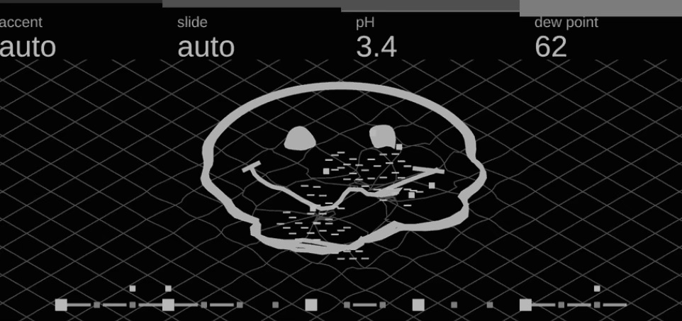
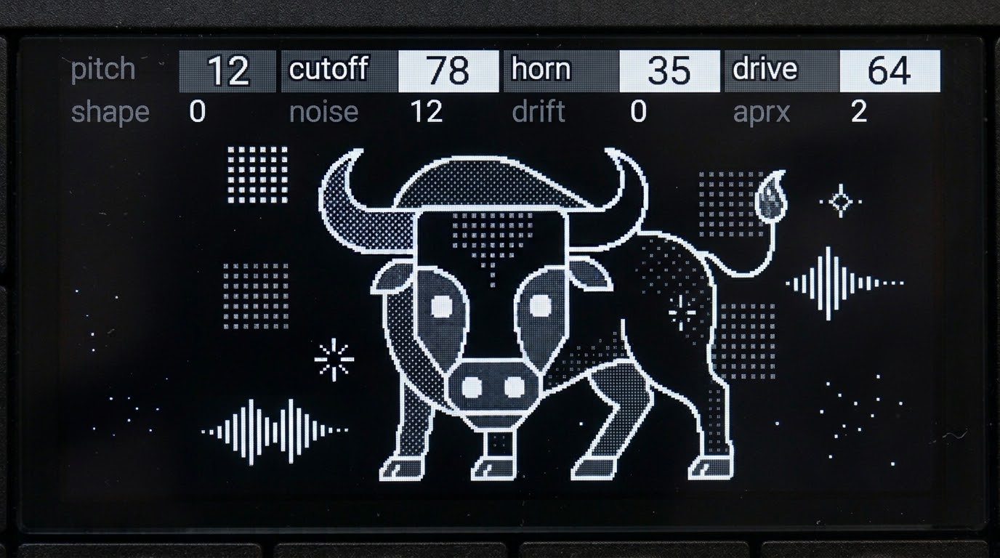

# Reference screens

Screens I learn from, annotated against `constraints.md` and `patterns.md`. Only my own captures live in this folder; other people's work is linked, not copied.

## field-and-figure.jpg

A capture at roughly 2× (962 × 453), so everything below is measured back at 1:1.

**Pattern:** P5 Field and figure. A ground mesh, one figure, an activity strip.

What works:

- **One subject.** The face-like outline is the only bright thing in the body; the mesh sits back in a low grey. Nobody wonders where to look.
- **Stock header, used well.** Real-unit values (`3.4` for pH, `62` for dew point) and named modes (`auto`). The values fit their columns.
- **Weight carries hierarchy.** The figure's outline is a thick ribbon (~3–4 px at 1:1); the inner detail is thin. Brightness and weight agree.
- **Strip as a separate layer.** The step strip along the bottom reads as timing information without competing with the figure.

What I'd check before shipping:

- **Label length.** `dew point` is 9 characters; ux.md caps labels at 8. `dewpt` or `dew` would fit the rule.
- **Inner dashes.** The small dash marks inside the figure are about 4–5 × 1 px at 1:1. That's under the ~3–4 px part guidance in the thin dimension, and if each is its own node, they're also the most likely thing to blow the ~20 changed-nodes budget when they move.
- **Mesh density.** The mesh is fine in the foreground, but anywhere it converges (toward a horizon) line gaps can fall under 3 px and turn into a grey smear. Fade it out before it gets that dense.
- **Mesh cost.** If the mesh moves, it has to move as a few nodes, never as re-keyed paths.
- **Strip markers.** The smallest strip squares look ~2–3 px at 1:1. Make the smallest state at least 4 px, and make "active" differ by size as well as brightness.

## toro-ink-rest.jpg and toro-ink-smoke.jpg

Two photos of the same toro screen on the device, shared by its owner (thoughtgrain): at rest, and with the steam up. Measured back to 1:1, the display's active area is at (83, 71)–(1283, 687) in the rest photo and (66, 50)–(966, 512) in the smoke photo; the vertical scale in both is about 12 % larger than the horizontal, which is the camera, not the panel.

**Pattern:** P9 One-bit ink. The bull is the hero; the steam is a layer one control brings in; the glyphs each belong to a control.

What works:

- **Hard edges only.** Every shape has a 2 px white outline; tone is ordered dither, never a grey value. Nothing anti-aliased, so nothing smears at 1:1.
- **Five tones are enough.** Black, 25 %, 50 %, 75 % and white carry the whole drawing (hide, horns, face, muzzle, eyes). The dither reads as texture, not as a grey ramp.
- **The steam is a state, not decoration.** Rest has none. That's the clearest possible "this control did something".
- **Glyphs with jobs.** The bar glyph, the swatches, the sparkles and the squiggles each sit where a control can own them.

What I'd check before shipping:

- **Dither cost.** A dithered plane is hundreds of 1 px marks, so it has to be static artwork; a tone change is a swap between pre-dithered layers, not a redraw.
- **Line breaks.** Some outlines (hind legs, horn interiors) break into 1 px gaps on the panel photo. Keep outlines a full 2 px.
- **The eyes at low cutoff.** A black eye on a black face vanishes; keep the outline so the socket still reads.

`screens/toro/concepts/ink_trace.py` traces both photos into clean one-bit art and builds toro's controls on top of them.

## Stock OP-XY engine screens (teenage engineering)

The house style, from teenage engineering's own engines. Linked, not copied: the [OP-XY guide, synth engines](https://teenage.engineering/guides/op-xy/synth-engines) lists the engines and their parameters; the screens are on the device and in TE's material. Labels below are what the screens shown to me read (some differ from the guide's current names). Annotated from captures at about 2.6× (1260 wide), measured back to 1:1.

What they share:

- **One object per engine, chosen for what it does.** A prism and lenses bending a beam (prism), a hair dryer (hardsync: a motor and a blast of air), a slinky on stairs (simple), a tambourine (drumline), stacked piano-key planes (epiano), a waveform (wavetable), a lattice of cubes (axis), a pixel field (dissolve). The object is a pun or a mechanism, never a dashboard.
- **Few values, used hard.** White or `#CDCDCD` outlines or masses, flat mid-grey fills, black ground. No gradients, no texture except where the object has it (the dryer's grille dots, the slinky's rings).
- **Line weight ~2 px for anything that matters** at 1:1; nothing hairline carries meaning.
- **Lots of black.** Every body leaves most of the screen empty around the object, well over the 40 % rule.
- **Three-quarter isometric for solids** (axis cubes, epiano planes, simple's stairs): one consistent projection, hidden-line, faces shaded by flat greys rather than lit.
- **Controls show as parts of the object:** the beam's angle through the lenses, the stairs' shades, the waveform's shape. Where a control has no part, a plain secondary mark carries it (hardsync's envelope line and its two dots, stepped blocks for the tone).

Per screen:

- **axis** (cubes; labels shape, ratio, shape, vibrato): an isometric star of cubes in four greys, three white ones with dot markers, a single bright line with a handle leaving the figure. The cubes' shades are the ratio between arms; the handle line is a control drawn as a slider in space.
- **dissolve** (pixel field; swarm, am, fm, detune): a full-screen field of square cells. The one engine that fills the screen; written up in full under *dissolve, in detail* below and as pattern P15.
- **drumline** (tambourine; pitch, decay, noise, tone): one double-outline drawing, centred, nothing else. Drumline changes instrument often (ten drum models), so each drawing is minimal and taken in at once. See `craft.md`, *Detail follows how often the subject changes*.
- **epiano** (stacked key planes; shape, ratio, detune, stereo): a white key plane in isometric over three grey grid planes that step down in value. The layers are the voices or partials; depth is value, not perspective tricks.
- **hardsync** (hair dryer; freq, sub, noise, lowcut): a solid white dryer, grille dots in two greys, a row of stepped grey blocks for the air, an envelope curve with end handles. The most "product drawing" of the set: solid masses, no outlines.
- **prism** (prism and lenses; shape, ratio, detune, stereo): a white outline prism, a grey convex lens, a dark concave lens, a white eye-like detector; one bright beam bends through them. The signal path is literally drawn left to right.
- **simple** (slinky on stairs; shape, pw, noise, stereo): four isometric stair treads in rising greys with white-outline slinky rings walking down them. Motion is the subject: the slinky's step is the oscillator's cycle.
- **wavetable** (waveform; buzz, position, warp, drift): a single white trace with a flat section and a burst; the trace is the sound. One 2 px line on black, nothing else.

### dissolve, in detail

The one stock screen that breaks "one object, lots of black", and why it gets away with it. Measured from Brian's capture (1260 × 576, about 2.6×), read back at 1:1.

**The sound.** TE's guide calls dissolve "a tonal noise synth engine, perfect for ambient pads and bright, noisy leads". Its controls: **swarm** modulates the oscillators with noise; **am** modulates the amplitude, adding grit; **fm** modulates the frequency, adding tonality; **detune** spreads each oscillator's pitch for a richer sound. No other pages are listed.

**The drawing.**

| property | measured |
| --- | --- |
| Grid | square cells about 10 px at 1:1 (26–27 px in the capture), touching with no gaps: about 48 columns × 20 rows below the header, roughly 960 cells |
| Values | black about 70 % of the body, white about 25 %, two dim greys (about `#303030` and `#606060`) about 5 %, a light grey rarely |
| Shape | nothing but cells; no outlines, no text, no figure. Lit cells clump into short runs and L-shapes, so the field reads as a texture, not as dots |
| Header | stock, flush with the top; values in real numbers (`49`, `52`, `90`, `00`) |

**Why it works.**

- **The field is the object.** A noise engine has no mechanism to draw. The screen draws the sound's texture instead, and because it's one uniform field (one cell size, one grid, a few values) it still reads as a single thing, not as clutter.
- **Hard edges only.** Square cells on a fixed grid, touching: nothing is anti-aliased, so nothing smears on the panel, and at arm's length the eye sees grain, not pixels.
- **White carries it; greys add depth.** White cells are the figure; the two dim greys sit between them like a second, quieter layer, the way a noise floor sits under a signal.
- **The header stays plain.** With the whole body busy, the header's real-unit numbers are the only text, and they read cleanly.

**What I can't tell from a still.** How each control moves the field isn't visible in one frame, so it isn't documented here as fact. A likely reading, to confirm on a device: swarm sets how many cells are lit and how fast they churn; am and fm set the grey layer and how lit cells clump; detune spreads clumps sideways. Mark any design built on this reading as **pending device**.

**If I build one on open-xy.** The stock screen isn't bound by the SDK's limits; mine is. About 960 cells won't fit 256 nodes, and churning them breaks the ~20 changed nodes a frame. So:

- **Coarser cells.** 20 px cells give 24 × 10 = 240 below the header; 24 px gives 20 × 8 = 160, which leaves room for the header and palette.
- **Value by palette, not geometry.** Each cell is one fixed square node; lit, grey or dark is a palette swap.
- **Churn within budget.** Flip at most about 20 cells a frame; a "swarm" that crawls cell by cell reads as motion and stays inside the redraw budget. At rest, nothing flips.
- **Runs, not dots.** Light neighbours together (runs of 2–4) so the field clumps like the stock one; single scattered cells read as dead pixels.

See P15 in `patterns.md` for the recipe.

What I take for my own screens:

- Pick the object from the machine's mechanism (P13's "find the machine's own rule" is the same move).
- Keep the drawing language to one projection and one line weight, and spend contrast only on what the player reads.
- Don't copy any of these objects or their arrangement; they're TE's, and every machine here needs its own.

## Linked references

- **MNMD** by Max Mockett ([site](https://mmockett.github.io/OP-XY/#mnmd), [source](https://github.com/mmockett/OP-XY-MNMD)). The clearest set of open-xy screens I've found. MD KIT draws each drum's sounding part in section like a patent drawing (P1); FM STAT, VO-6 and DPRO-DENS split structure left and output trace right (P2); SID-6581 and SWAVE-PULSE make the trace the subject (P3); DPRO-WAVE stacks wave frames in depth (P4). Two-page header throughout, inactive row in grey.
- **Found Motive kit** ([site](https://foundmotive.com/opxy/)). Useful as the counter-example: several machines (Shaker, Upright Bass, Phase, Tape, Tape Loop) keep the stock page, and Choir uses a figurative singers animation (P6). Shows that Gate 0 is a real decision, not a formality.
- **open-xy core machines** ([source](https://github.com/etcetc000/open-xy-core-machines)). Macro Osc is the reference implementation for every ux.md convention, including the two-page header; 2op FM shows outlines and pulses in `display.cpp`.
