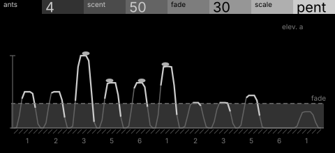
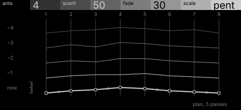

# ants · shortlist

Ants walk a lattice of scale degrees leaving scent; trails strengthen into repeated phrases and fade when unused. Controls: ants, scent, fade, scale.

I looked at all five rest sketches at 1:1 and shortlisted two. This is a shortlist, not a pick: the pass stays open (`ready_for_pick`) until the owner chooses with `design_pass_select`.

## 1. v2 · P13 Capture, orthographic elevation

Each walked degree builds a mound of scent and fade is a waterline that drowns what the colony stops walking: the strongest picture of the rule.

## 2. v3 · P14 Loom, survey plan

Passes as traverses across eight stations, newest in front: the only variant that shows a phrase setting as rows come to match. Close to a line chart.

## The other three

v1 (P12, typeset diagram), v4 (P5, patent section), v5 (P11, hidden-line isometric): see `notes.md` for what each one is and why it ranked lower.
