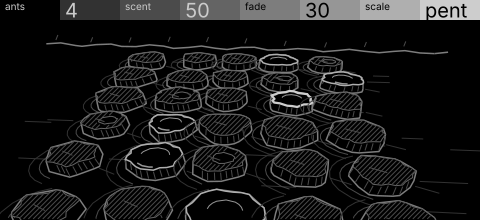
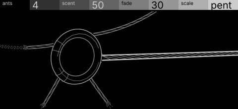

# ants · shortlist (pass 03)

I looked at all five at 1:1 and shortlisted two. This is a shortlist, not a pick: the pass stays `ready_for_pick` until the owner chooses.

## 1. v3 · a ford of stepping stones, detailed line art

It's the one where the machine's rule reads without explanation: the stones everyone steps on are worn bare and dished, the ones nobody uses are mossed over (hatched), and the stone being stepped on now is the bright one. Used paths stay clear and neglected ones grow over, which is scent and fade without drawing an ant. It's a real place, so it doesn't look like a diagram. It's busy, though: about thirty stones with ripples and moss. If it's picked, I'd thin it to fewer, larger stones and less ripple so it's as calm as the rest of the set.

## 2. v4 · one iron ring and its ropes, hidden-line 3D

The calmest of the five and the most like the OP-XY: mostly black, one subject, one bright element. The way the colony takes is a thick taut rope; the ways it's dropped hang slack and have frayed through, hatched past the break. That's reinforcement and fading as a physical thing under strain. The risk is that it reads as a mooring before it reads as a colony, and the phrase order isn't in the picture yet.

## The other three

- **v1**, a marble board with sprung rocker gates: the clearest mechanism, but dense, and it reads as a Galton board (chance) first. It's the runner-up.
- **v2**, sand grains seen close: busy at 1:1 and far over the node budget.
- **v5**, a swept loop through twigs: reads as a race track or pool, and sits close to pass 01's loop.
