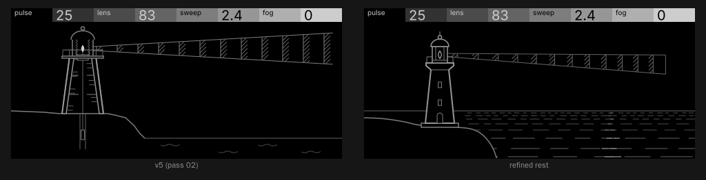

# Beacon · refined subject (pass 02, v5)

The owner picked v5 (the headland, the tower cut open) and said: keep the angle, simplify it, no cutaway, and turn the waves on the right into surface ripples. That's a clean-up of a pick, not a generative pass, so there's one design here, not five. Everything comes from `build.py`, one model and one camera, drawn at 480 × 220 and judged at 1:1.

## What changed and why

- **The tower is whole, seen from outside.** I took out the section entirely: no stair treads, floors, clock, weight shaft, lens profile or cut walls, and nothing sunk into the rock. What's left is a closed tapered outline at Subject weight (2 px, `#969696`) on a black body, with the details that say "lighthouse" on their own: a plinth, an arched door, two small windows, the corbel under the gallery, the gallery deck and its rail, the lantern with two astragals and a sill, the dome, the ventilator ball and a finial. Each detail is a single closed shape or one hairline, at least 4 px from its neighbours.
- **It's bigger.** v5's tower was about 60 × 130 px with 3–6 px section detail inside it. This one is 48–58 px wide at the base and 140 px from plinth to finial (y 34–174), and none of the detail inside is finer than 4 px, so it reads at 1:1. The finial stops 14 px under the header.
- **One clean headland.** v5's rock was a jagged polyline with a shaft cut into it. Now it's one smoothed profile (`LINE`, `#7D7D7D`) from the left edge under the plinth and down the cliff into the sea, with a black body behind it.
- **A horizon.** v5 had a waterline low in the frame and wave glyphs below it. The sea now has a real horizon at y 150, the camera's eye height, so the ripples have somewhere to recede to and the beam has a sea under it.
- **The beam is modelled, not drawn flat.** The lamp sits at the tower's depth, and the beam is a cone turning about the tower's axis, projected through one camera (focal 420, horizon 150). That's what makes sweep honest: turning away, the beam's end draws in and drops toward the horizon, and its bands crowd together with distance.
- **The beam is quieter than the tower.** At rest the beam is hairline `#646464` throughout: two edges, the bands' 45° hatching and each band's outer edge. It's "there but not active" (`craft.md`, semi-opaque areas), so the eye goes to the tower first. That was v5's main risk.
- **One brightest element: the lamp.** The lamp is the only `#CDCDCD` on the screen, at rest and while playing. It's where the sound starts (the exciter), it sits at the top of the subject, and it's the one thing a note changes first. At rest it's a hollow vesica outline in the lantern; on a note it fills and grows 1.6×. Nothing else reaches `#CDCDCD`: the glints and the travelling wavefront top out at `#AFAFAF` and the lit beam at `#969696`.

## The ripples

The little wave glyphs are gone. The sea is six horizontal ripple rows (hairline, `#4B4B4B`) at 4, 10, 18, 29, 44 and 63 px below the horizon, so they come closer together toward the horizon, and their dashes go from about 12 px with short gaps far off to 50–110 px with long gaps close in. They start just right of the tower and run behind the headland, so the cliff cuts them off naturally.

Where the beam's light catches the water there's a **glitter path**: brighter dashes (`#7D7D7D` at rest, `#AFAFAF` while lit) laid on the rows, one per row far off and two or three close in, centred under the beam's far reaches (72 % of its length). It narrows toward the horizon like a real glitter path. Lens widens or narrows it with the beam, and sweep carries it: as the beam turns away, the path slides left toward the cliff.

What I decided they do: **the ripple rows themselves never move**; only the glints do. While a note is held they follow the beam as it turns and shimmer by a pixel or two. On release they dim back where they are, and at rest the whole sea is still. Moving the rows as well would cost about 35 nodes a frame for very little.

## How it plays

| | what moves | from → to |
| --- | --- | --- |
| **note on** | the lamp fills and grows; the beam's bands brighten outward from the lantern in a short cascade; the edges go to Line weight; the glitter brightens and lengthens | lamp hollow → filled, 1 → 1.6×, ease ~0.18 s; bands `#646464` → `#969696`, cascade over ~0.3 s; glints `#7D7D7D` → `#AFAFAF`, 1 → 1.6× long |
| **held** | a bright wavefront (`#AFAFAF`) runs out along the beam, one band edge every two frames, every fourth band, so pulses visibly leave the lantern; with sweep above 0 the beam leans away and back at the fixed 0.5 Hz, and the glitter path follows it | lean 0° ↔ the sweep's full lean |
| **pulse** | each band's width as a share of the comb period (the pulse width, literally) | 3 → 27 world units of every 30: thin flashes → a nearly solid beam |
| **lens** | the cone's spread (focus), and the glitter path's width with it | half-angle 5.2° → 1.0°: a wide fan → a near-parallel shaft; the far end goes from ~74 px to ~16 px tall |
| **sweep** | the beam's lean away from the viewer, shown at rest as the pose the light leans to; its end draws in and drops toward the horizon, its bands crowd, and the glitter slides left | 0° → 68°: end at x 470 → about x 245, about 40 px lower |
| **fog** | a hatched bank (`#4B4B4B` hatching on a black body, at 45° the other way) rises off the sea behind the headland and the tower. It hides the far sea and swallows the sky, and **inside it the beam's bands run together into one continuous hatch**: the clicks smear into a breathy tone. The beam's outline carries on through it, because the pitch survives. | bank top at the horizon → 95 px above it (y 55); nothing at the default 0 |
| **release** | the lamp empties and shrinks, the bands dim back toward the lantern, the beam eases back to its rest pose, the glints dim in place; then nothing changes | ~0.6 s, then still |

Reduced motion and track change jump to the end state (lamp hollow, beam at rest pose, glints at rest).

`motion.gif` is 6.4 s at 25 fps and 1:1: rest, a note held for 4 s while the beam leans twice and returns, then the release settling. I set sweep to 50 (6.0 st) for it so the turn is easy to see; everything else is at the defaults. `playing.svg/png` is an extra frame (defaults, note held, one wavefront out) for the note-response check.

## Checks

- **Lint:** `python3 opxy/tools/lint_frame.py screens/beacon/frames/*.svg` gives 0 errors and 0 warnings across all 14 frames (rest, playing, and 0 / 50 / 100 for each control). There's no text in the drawing, and the most points in any path is 56.
- **Black share of the body:** 92.6 % at rest; lowest 81.1 % at fog 100, against the 40 % floor.
- **Header:** beacon's titles with the default values `25 · 83 · 2.4 · 0`. Amounts have no `%`, and lens shows the mapped feedback (0 / 70 / 99). Nothing touches the header: the highest lit body pixel is y 34 in every frame.
- **Perceptibility:** I ran `opxy/tools/perceptibility.py` on each control's 0 / 50 / 100 plus rest → playing (copied to `c<N>-<v>` names in a scratch folder, since deleted), with scores 3, 5, 3, 4 from the brief:

| control | score | need | 0→100 | 0→50 | 50→100 | span | |
| --- | --- | --- | --- | --- | --- | --- | --- |
| pulse | 3 | 1.20 % | 2.12 % | 1.41 % | 1.16 % | 297 px | ok |
| lens | 5 | 2.50 % | 3.41 % | 2.66 % | 2.61 % | 300 px | ok |
| sweep | 3 | 1.20 % | 3.47 % | 3.96 % | 2.41 % | 348 px | ok |
| fog | 4 | 1.60 % | 12.82 % | 8.02 % | 6.52 % | 480 px | ok |
| note response | — | 2.00 % | 2.48 % | — | — | 317 px | ok |

  The note response first came in at 0.48 %. Lifting the lit beam from `#7D7D7D` to `#969696` (one hairline step didn't clear the 24/255 floor after anti-aliasing), lengthening the lit glints and taking the lit edges to Line weight brought it to 2.48 %. Pulse has the least margin (1.16 % on its upper half against the 0.48 % half-floor, and 2.12 % overall).

## Node plan and redraw estimate

The frames here are sketch-stage (no bound IDs yet); this is how I'd build them on the device. Element counts are from `build.py`.

| part | how it's built | nodes | changes when |
| --- | --- | --- | --- |
| tower, plinth, door, windows, rail, lantern, dome | static | ~21 | never |
| headland, horizon | static | 4 | never |
| ripple rows | static dashes | 35 | never |
| glints | static ribbons, translated (and shaded) | 12 | sweep turn, held-note follow and shimmer, note on/off |
| lamp | one vesica: paint stroke → fill and stroke, uniform scale 1 → 1.6 | 1 | note on, release |
| beam cone | **mutable outlines 0–2** (`paths` 3, 4 points): three black quads, each ≤ 128 px long, filled and stroked so their long sides are the beam's edges; the joins fall on band wavefronts, so a join reads as one | 3 | lens, sweep (turn and held lean) |
| band hatching | static 45° ribbons, one set per band slot authored at pulse 100 and revealed by pulse; placed and scaled to the cone by lens and sweep. Inside the fog, a band shows its full set (the smear) | ≤ 126 at pulse 100 / lens 0; 40 at the defaults | pulse, lens, sweep, fog turns; held-note lean; note on/off shade |
| band wavefronts | static ribbons | 12 | shade while held, placed by sweep |
| fog | one black body plus ~70–90 hatch ribbons that translate up together; a black near-sea body in front hides their feet; the cone bodies hide the hatch inside the beam | ~95 | fog turns only |

So that's 3 paths and about 310 nodes, or about 435 if the hatching needs two lengths per slot (see Pending). Either is more than 256, so it needs `"sdk": "1.8"` (≤ 512), unless the band hatch goes to a 6 px pitch. The display placeholder in `definition.json` (1 path × 64, 32 nodes) has to be redone in phase 4. Palette: 8 greys.

**Redraw (changed nodes per frame):**
- **Rest:** 0. Once the release has finished (~0.6 s), nothing changes.
- **Held, sweep 0:** wavefront shading 2, glint shimmer ~4 (a third of them each frame), so **~6**.
- **Held, default sweep (2.4 st, 0–14° of lean at 0.5 Hz):** the beam's geometry drifts under a pixel a frame, so I update it on a staggered schedule: a quarter of the beam's nodes each frame (15 Hz each). That's 1 cone path, ~10 hatch, ~3 wavefronts, ~4 glints and 2 wavefront shades, so **~20 on average**, peak ~24.
- **Heaviest (pulse 100, lens 0, sweep 100):** the same scheduler over eight groups (7.5 Hz per band) gives 1 path, ~16 hatch, 2 wavefronts, ~4 glints and 2 shades, so **~25 on average** and peak ~30. That's a little over the ~20 guideline. Where it lags, it's in the slow lean of distant hatching.
- **Note on / release:** the hatching cascade re-shades ~40 nodes over ~18 frames, plus the lamp: **+3 a frame** for 0.3 s.

## Pending

- **Device:** every device check: legibility of the 4–5 px windows and astragals, the glitter reading as light on water rather than texture, the fog hatch at 7 px on the real panel, and the real redraw cost (graphics aren't in open-xy's CPU profile).
- **Hatch line length:** the band hatching changes length with lens and perspective, but a static node can only change length by uniform scale, which also thins or thickens the ribbon. I'd author each slot's lines at two lengths and keep the scale within ~0.75–1.35 (about 0.75–1.35 px wide). That doubles the band hatch nodes, which the count above doesn't include. It's unproven, and the biggest implementation risk.
- **Mutable stroke at the joins:** whether a filled-and-stroked mutable outline's stroke lands cleanly enough that the cone joins disappear into band wavefronts.
- **Phases 4–8:** the brief's mapping table and budget, `resources.display`, `motion.md`, review and handoff are all still to do for this subject.
