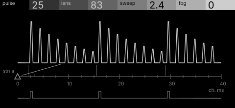
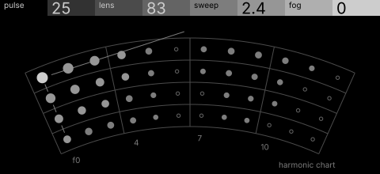

# beacon · shortlist

A pulse train through a comb 'lens' that focuses it into a pitch, swept by a rotating light, softened by fog. Controls: pulse, lens, sweep, fog.

I looked at all five rest sketches at 1:1 and shortlisted two. This is a shortlist, not a pick: the pass stays open (`ready_for_pick`) until the owner chooses with `design_pass_select`.

## 1. v1 · P3 Trace as subject, survey plan

The pulse train focused into pitch, drawn as a survey chain with the input train under it: true to the DSP and calm.

## 2. v4 · P10 Voice field, star atlas

The comb's harmonics as a star atlas, the fundamental the brightest star: the most original, though close to a dot grid.

## The other three

v2 (P4, patent section), v3 (P5, hidden-line isometric), v5 (P14, engineering schematic): see `notes.md` for what each one is and why it ranked lower.
