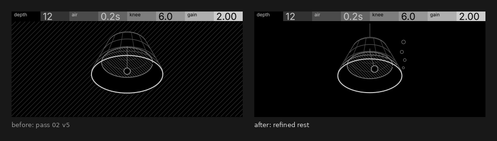
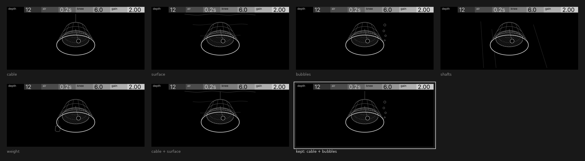
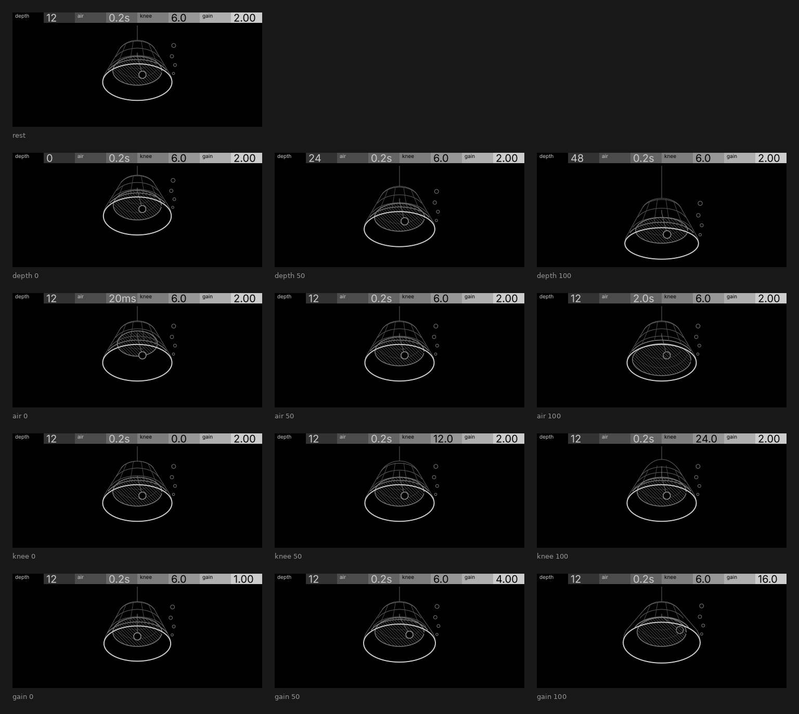

# Bell · refining pass 02 v5

The owner picked v5 (looking up into the mouth from below) and asked for two things: take out the hatched background, and think about simple ways to ground the bell. Everything here comes from `build.py`. That script imports pass 02's `sketch.py` model and camera unchanged and adds the grounding, a domed crown for the knee, the sound-bow flare and the clapper's swing for gain, and the header captions.

## What changed

- **The hatched water is gone.** The ground is black now, and the body is 94–96 % black in every frame (v5 was well under that). The only hatching left is on the water's surface inside the mouth. Seen from below, that surface is a semi-opaque boundary you look through into the air pocket, so hatching it is the honest choice, and it still reads at 1:1.
- **The camera is v5's**: same position, same look-at. I refitted it to a box of 110–370 × 40–207 so depth's whole travel fits, along with the domed crown at full knee and the widest lip at full gain. Nothing clips, and nothing comes within 5 px of the header (the highest pixel in any frame is at y 25). The bell is a touch smaller than v5's (rim about 135 px wide at rest against v5's 150) because it now needs room above for the cable and the dome.
- **The knee now really moves.** In v5 the knee only filleted the shoulder. From below, that shoulder shows only in the silhouette, and it moved by a few pixels (0.96 % of the body here before I fixed it, and barely visible in the contact sheet). Now the knee also domes the crown, by 0 → 0.42 of the rim radius. At a hard knee you get a flat top on a sharp shoulder, a truncated cone. At a soft knee the crown rises into a round dome, like a church bell. That's a soft knee drawn literally, and the silhouette's top moves about 20 px.
- **Gain was rebuilt** (the floor v5 flagged). I tried the clapper's swing on its own first: 0 → 46° of rotation, the ball travelling about 40 px across the mouth. It cleared the 40 px spread floor (51 px) but changed only 0.30 % of the body, against the 1.6 % that a score-4 control needs. A 16 px ball is just too small. So gain now does two things on the bell's business end:
  - the **sound-bow flares**: lip width 0.02 → 0.24, so the bright rim's radius grows about 15 % while the mouth stays put. A heavier bow is a louder bell.
  - the **clapper is drawn back** from plumb: at ×1.00 it hangs straight down (nothing added), at ×16 it's 46° out, with its travel as a dashed hidden-line arc.

  Together they come to 3.03 %, spanning 158 px. The two parts sit at the lip and inside the mouth, a different place and channel from depth (the whole bell moving and growing), air (the waterline) and knee (the crown).
- **The clapper hangs from a staple at the crown's inside**, so the dome doesn't drag the ball up with the knee. The ball is drawn behind the water's hatching when it's in the air pocket and in front when it's in the water (above or below the waterline). It's a small physical touch, and it costs nothing.

## Grounding: what I tried and what I kept

All six are in the same model and camera, each alone on the rest frame, plus the pair I kept.

| cue | at 1:1 | verdict |
| --- | --- | --- |
| **cable** rising from the crown out of the picture | One hairline, and it says "lowered from above" instantly; it's the classic diving-bell cue. Depth pays it out: the line runs 25 → 47 px at depth 0 and 25 → 98 px at 48 dB, so it adds scale and depth's travel for free | **kept** |
| **sea surface**: ripple crests on the surface plane, receding | With v5's camera looking up, the surface is a ceiling over the whole background. Its crests close up and shorten as they recede, and they recede downward, behind the bell's top. At 1:1 that's three wavy lines crowding the header (the nearest sits about 2 px under it) and crossing behind the crown, so it reads as background texture, not as "far above". Pushing the surface higher sends it into the header | dropped |
| **bubbles** escaping under the lip | Four small circles (4–9 px) rising past the right wall and growing as they rise. They say "under water" and "air" in one cue, and they sit in world space on the rim, so they move with depth and gain | **kept** |
| **light shafts** from the surface | Three G50 hairlines. At 1:1 they read as scratches or stray construction lines, not light; with no fill there's nothing to make them light | dropped |
| **ballast weight** below the lip | Reads as a blob hung off the rim. It competes with the bright rim, and a seabed line is impossible from this camera: the seabed projects below y 440 | dropped |
| **cable + surface** | The cable gets something to hang from, but the surface's problems stay | dropped |

**Kept: cable + bubbles.** These are the two cues that read at 1:1 as "a bell lowered into water" without adding a background. Both stay hairline or mid-grey, the rim stays the one bright element, and the body stays about 95 % black. The cable stops at y 25, 5 px under the stock header, so it reads as running up out of view without touching the header. On the device it can be one fixed node that the bell's body hides at the bottom end, so it never redraws.

## Interactions

| control | score | what moves | channel | 0→100 | 0→50 | 50→100 | span |
| --- | --- | --- | --- | --- | --- | --- | --- |
| depth | 5 | the bell comes down toward the camera on a longer cable: it lowers about 46 px and grows about 1.08×, with the rim leading | position + size from distance | 7.26 % | 6.13 | 6.50 | 164 px |
| air | 3 | the waterline ellipse and its hatched water drop from high in the bell toward the rim as the pocket grows from ⅓ to 9⁄10, and the pocket's inner hoops follow it | position + area | 2.84 % | 1.61 | 2.15 | 114 px |
| knee | 2 | the crown goes from a flat top on a sharp shoulder (0 dB) to a round dome (24 dB) | shape (about 20 px) | 0.96 % | 0.94 | 1.12 | 108 px |
| gain | 4 | the sound-bow flares (rim radius +15 %) and the clapper is drawn back 0 → 46° | shape + rotation | 3.03 % | 3.00 | 3.08 | 158 px |

`python3 opxy/tools/perceptibility.py` (header bottom 20; scores from the brief: 5, 3, 2, 4): **pass**, every control and every half. Knee is the thinnest: 0.96 % against a 0.80 % floor. That's fine for a score-2 control, but it's the one to keep an eye on on the device.

## What an effect page can react to

Nothing live. open-xy `docs/display.md`, Effect pages (SDK 1.7): "Its input's `slots` hold all eight of its controls, `track` is the send (14 or 15), and two fields follow the note activity: `shift` … and `choices`". Under Note activity: "Non-instrument tracks report zero." So a send gets no notes, no audio, no level, and no transport or tempo. The input does carry `elapsed` (a clock), but `ux.md` says an idle screen stays still ("Motion answers the player"), so there's nothing to drive with it.

**So the picture changes only when a control moves.** Each change is an exponential ease-out that settles in 0.15–0.2 s, and the screen stays still at rest. `sweep.gif` is that: each control turned to 0, up to 100 and back to its default, at 1:1 and played back at preview speed. The bubbles are fixed in the world on the rim. They move with the bell, but they don't animate on their own. A small rise when depth or air turns would be the natural next step, but it would be decoration on a turn, so I left it out.

## Node plan and redraw

Each frame has 46–53 drawn leaves. Here's how I'd lay them out on the device (palette 7, texts 0, points ≤ 64):

| part | kind | count | changes on |
| --- | --- | --- | --- |
| silhouette / dark body | mutable path 0 | 1 | depth, knee |
| bright rim with the bow flare | mutable path 1 | 1 | depth, gain |
| waterline ellipse | mutable path 2 | 1 | depth, air |
| water hatching, one serpentine outline (about 12–15 lines at 4 px; its joins run along the waterline, which is drawn over them) | mutable path 3 | 1 | depth, air |
| exterior ribs (only the part below the shoulder; the knee's dome doesn't touch them) | nodes, scale + translate | 12 | depth |
| shoulder and wall hoops, bow hoop | nodes, scale + translate | 6 | depth, knee (shoulder hoops) |
| pocket's inner hoops | nodes | 3 | air, depth |
| staple + clapper rod | nodes (the rod turns about its pivot) | 2 | gain, depth |
| clapper ball | circle node | 1 | gain, depth, air (draw order) |
| swing arc dashes | nodes, shown or parked | 8 | gain |
| bubbles | circle nodes | 4 | depth, gain |
| cable | node, fixed, its lower end hidden by the body | 1 | never |

That's about 41 nodes, including the 4 paths. `definition.json` declares paths 1, nodes 64; it would want `paths: 4` (I haven't touched it). Depth as a near-uniform scale and translate of the projected bell is an approximation of the perspective, which is good to about a pixel over the bell's 1.08× travel. That needs checking in the handoff.

Redraw: **zero at rest**, and there are no notes on a send, so the only cost is during a turn's 0.2 s ease. Per frame of that ease:
- depth: everything but the cable, about 40 nodes.
- knee: path 0 plus the shoulder hoops, about 4.
- air: 2 paths, the hoops and the ball, about 6.
- gain: path 1, rod, ball, up to 8 dashes and 4 bubbles, about 15.

Depth is over the "~20 per frame" figure, but that figure is a note budget (`constraints.md`, Redraw), and this is a short ease on a turn, not a sustained load. Still, it's worth timing on the device.

## Lint and checks

- `python3 opxy/tools/lint_frame.py` on all 13 frames: **0 errors, 0 warnings**, no `text-in-drawing`.
- No text or numbers in the drawing, no grey-fill states (the only fills are black bodies), and grey only, with no red.
- 94.2–95.9 % of the body is black. The highest artwork is at y 25, and nothing clips at either end of any control (the lowest is y 205, at depth 48 dB).
- Every frame was checked at 1:1. The header shows bell's titles, with the defaults on rest (`12`, `0.2s`, `6.0`, `2.00`). Each control frame shows its own value at 0 / 50 / 100: depth `0` / `24` / `48`, air `20ms` / `0.2s` / `2.0s`, knee `0.0` / `12.0` / `24.0`, gain `1.00` / `4.00` / `16.0`.

## Pending

- Everything on the device: there's no browser preview for effect pages, so these are stills.
- How the `ratio` and `duration` captions round. `12.0` and `24.0` are 4 characters, and I haven't measured them in Univers.
- Whether the knee's 0.96 % reads on the real screen.
- Whether depth's ~40-node ease is smooth.
- The scale + translate approximation for depth.
- `definition.json` `resources.display` (paths 4, about 41–48 nodes, palette 7) waits for the phase-4 handoff.
- The owner's call on two things: the dome for the knee (it's a new reading, not v5's), and gain as the lip flare plus the clapper together.
