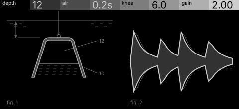
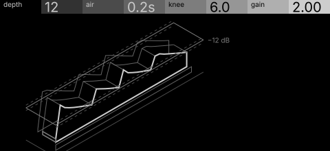

# bell · shortlist

A compressor as a diving bell: depth is the threshold, the air pocket is the release, the knee is how the bell settles. Controls: depth, air, knee, gain.

I looked at all five rest sketches at 1:1 and shortlisted two. This is a shortlist, not a pick: the pass stays open (`ready_for_pick`) until the owner chooses with `design_pass_select`.

## 1. v1 · P2 Diagram + trace, patent section

The diving bell on its cable beside the compressed signal pressed inside its grey input: the bell and what it does, side by side.

## 2. v2 · P3 Trace as subject, hidden-line isometric

The envelope as a hidden-line wall pressed below the input through a water plane at the threshold: the truest picture of compression.

## The other three

v3 (P4, star atlas), v4 (P10, engineering schematic), v5 (P6, oscilloscope trace): see `notes.md` for what each one is and why it ranked lower.
