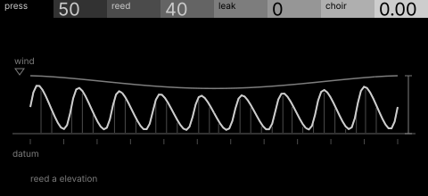
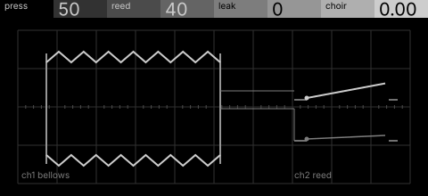

# bellows · shortlist

A free-reed voice blown by a bellows whose pressure sags and recovers; leaks add breath, a second reed beats against the first. Controls: press, reed, leak, choir.

I looked at all five rest sketches at 1:1 and shortlisted two. This is a shortlist, not a pick: the pass stays open (`ready_for_pick`) until the owner chooses with `design_pass_select`.

## 1. v4 · P3 Trace as subject, orthographic elevation

One reed wave in elevation whose roofline is the wind sagging and recovering: the machine's defining behaviour, with plenty of black.

## 2. v2 · P1 Section drawing, oscilloscope trace

The bellows itself on a scope graticule: pleats, board and two reeds, each control a physical part. The graticule competes; worth softening.

## The other three

v1 (P15, engineering schematic), v3 (P2, typeset diagram), v5 (P12, survey plan): see `notes.md` for what each one is and why it ranked lower.
