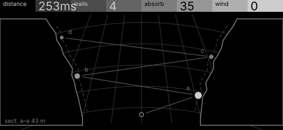
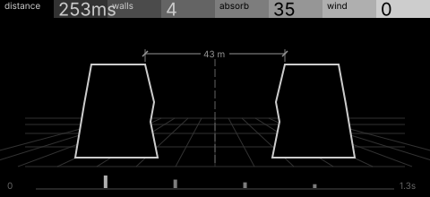

# canyon · shortlist

Multi-tap echo shaped by canyon walls: the distance sets the delay, walls set the tap count, rock absorbs highs, wind modulates. Controls: distance, walls, absorb, wind.

I looked at all five rest sketches at 1:1 and shortlisted two. This is a shortlist, not a pick: the pass stays open (`ready_for_pick`) until the owner chooses with `design_pass_select`.

## 1. v4 · P1 Section drawing, star atlas

The canyon cut across as a star chart, echoes as lettered stars zig-zagging up the walls: reads as canyon and echo at once.

## 2. v5 · P5 Field and figure, engineering schematic

Two walls in a perspective plane with the tap strip below: the plainest picture of distance and walls. Its strip reads a little like a meter.

## The other three

v1 (P4, survey plan), v2 (P10, patent section), v3 (P15, hidden-line isometric): see `notes.md` for what each one is and why it ranked lower.
