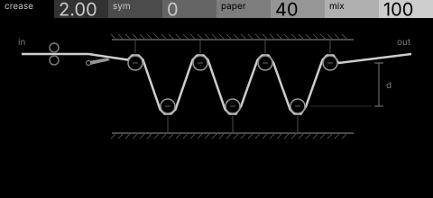
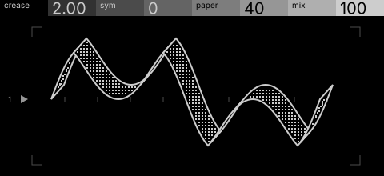

# crease · shortlist

A wavefolder for any track: the signal is folded like paper, with symmetry and a soft paper limit. Controls: crease, sym, paper, mix.

I looked at all five rest sketches at 1:1 and shortlisted two. This is a shortlist, not a pick: the pass stays open (`ready_for_pick`) until the owner chooses with `design_pass_select`.

## 1. v4 · P1 Section drawing, engineering schematic

A folding press in section, the paper web festooned over two roller banks: one bright subject, every control a part.

## 2. v5 · P9 One-bit ink, oscilloscope trace

A paper streamer folded into the output wave, two faces in dither: the strongest image. On the device the dither becomes flat greys, so the frames pass has to redraw it.

## The other three

v1 (P4, patent section), v2 (P10, hidden-line isometric), v3 (P15, star atlas): see `notes.md` for what each one is and why it ranked lower.
