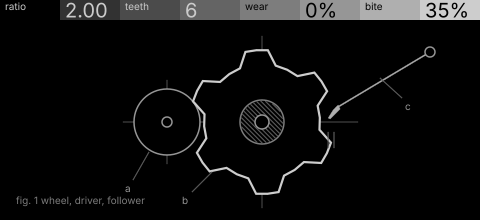
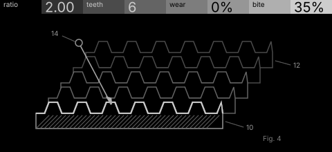

# drill · shortlist

Phase distortion driven by a gear train: the read phase is bent by a toothed wheel whose ratio and wear shape the timbre. Controls: ratio, teeth, wear, bite.

I looked at all five rest sketches at 1:1 and shortlisted two. This is a shortlist, not a pick: the pass stays open (`ready_for_pick`) until the owner chooses with `design_pass_select`.

## 1. v1 · P1 Section drawing, typeset diagram

One chunky gear with a follower biting its teeth: the closest to the stock one-object look. Note the header shows '%' on amounts, which needs dropping.

## 2. v4 · P4 Stack in depth, patent section

The rim unrolled into hatched strips stacked one per turn, staggering for non-integer ratios: the most original picture. Needs a second ratio cue at whole ratios.

## The other three

v2 (P2, orthographic elevation), v3 (P3, survey plan), v5 (P12, hidden-line isometric): see `notes.md` for what each one is and why it ranked lower.
