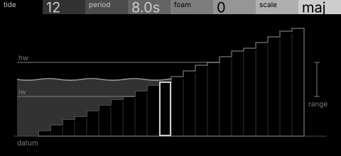
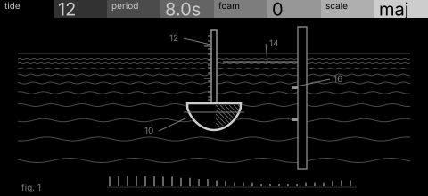

# ebb · shortlist

Notes rise and fall with a tide over a scale: the tide's height picks the register, foam scatters grace notes at the turn. Controls: tide, period, foam, scale.

I looked at all five rest sketches at 1:1 and shortlisted two. This is a shortlist, not a pick: the pass stays open (`ready_for_pick`) until the owner chooses with `design_pass_select`.

## 1. v1 · P13 Capture, orthographic elevation

A stepped scale in elevation with the tide line flooding it: register as water level, unmistakable.

## 2. v3 · P5 Field and figure, patent section

A buoy and tide gauge in patent section over the swell: calm, authored and physical.

## The other three

v2 (P14, survey plan), v4 (P12, hidden-line isometric), v5 (P10, star atlas): see `notes.md` for what each one is and why it ranked lower.
