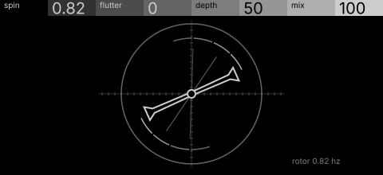
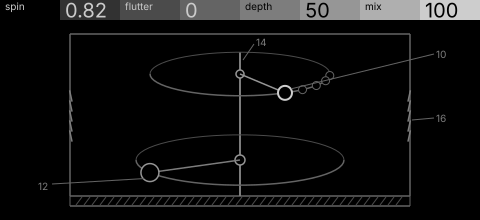

# eddy · shortlist

A rotating speaker drowned in turbulence: spin sets the rotor, flutter adds eddies to its speed, depth sets the doppler. Controls: spin, flutter, depth, mix.

I looked at all five rest sketches at 1:1 and shortlisted two. This is a shortlist, not a pick: the pass stays open (`ready_for_pick`) until the owner chooses with `design_pass_select`.

## 1. v1 · P1 Section drawing, oscilloscope trace

A twin-horn rotor on a scope graticule with phosphor trails: one bright object, mostly black.

## 2. v5 · P12 Orrery, patent section

The cabinet as a two-body orrery (horn and drum on one shaft): the orbits are the mechanism itself. The frame and louvres need calming.

## The other three

v2 (P2, typeset diagram), v3 (P3, orthographic elevation), v4 (P4, survey plan): see `notes.md` for what each one is and why it ranked lower.
