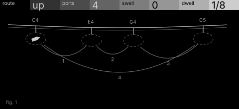
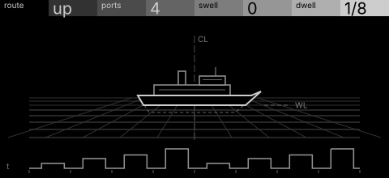

# ferry · shortlist

A ferry on a route between ports (chord tones), held up by swell and dwelling at each port before it plays. Controls: route, ports, swell, dwell.

I looked at all five rest sketches at 1:1 and shortlisted two. This is a shortlist, not a pick: the pass stays open (`ready_for_pick`) until the owner chooses with `design_pass_select`.

## 1. v3 · P13 Capture, typeset diagram

A bay from above with piers spaced by chord intervals and capture rings at each pier head, numbered legs across the water: the machine's own rule, authored.

## 2. v1 · P5 Field and figure, engineering schematic

The ferry itself in elevation with its timing strip below: immediately readable. Only swell moves the bright ferry; the strip carries the rest, so the frames pass would need to rebalance it.

## The other three

v2 (P12, oscilloscope trace), v4 (P14, orthographic elevation), v5 (P4, survey plan): see `notes.md` for what each one is and why it ranked lower.
