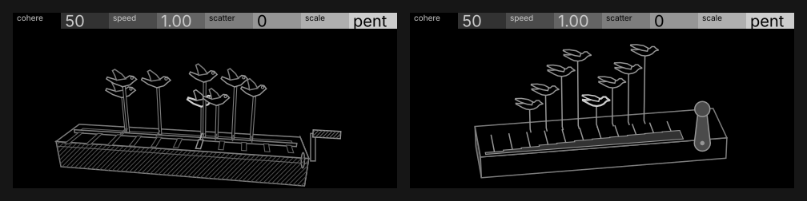

# Flock · v5 refined

The owner picked v5 from subject pass 02 and asked for "v5 slightly simplified, with maybe fills on the box for birds." This is that cleanup: the same subject (a crank automaton, eight carved birds on rods riding a slot over a tuned comb) with the same channel for each control. It edits the pick, so it isn't a new five-variant pass. Everything comes from `build.py`, modelled in 3D and projected through one camera. `python3 screens/flock/frames/build.py --check` rebuilds every file here and prints the numbers below.

## What changed and why

- **The box is now a solid body.** I took the hatching off the front face, which was the one place a hatch meant "shade" instead of "there but not active". The three faces are now flat greys by their light, with crisp `#7D7D7D` outlines at the Line weight, so the box reads as wood. The light comes from above and to the right. Fills below.
- **Fewer parts.** Gone: the plinth line, the bird eyes, the hatched crank boss, the hatched handle and the separate slot outline. The slot is now a plain black groove. The comb is a real music-box comb: thin steel tongues with their tips in a straight line where the picks reach them, rooted in a darker bar whose back edge steps forward under the long, low tines on the left. You can read it, but it stays quiet (hairline bar, Line-weight tongues).
- **One part per bird, plus a wing.** Each bird is one carved silhouette with a separate wing blade pinned at the shoulder. Each rod and its pick are one lever: the rod runs down through its carriage in the slot, and its lower end is the pick, reaching forward over the comb's tips. Bird, rod, pick and tine all sit in one vertical column, so you can see which tine a bird is playing.
- **The birds never touch.** v5's birds bunched over the same tines. Now they sit on four tiers 0.67 apart (more than a bird's height), and the tiers rise left to right in two runs, so each bird's raised wing (which points back, to the left) opens away from its neighbour. The two birds on a tier are 1.2 of the flock's spread apart, more than a bird's length even when the flock is fully gathered. Closest gap at the defaults: **5.9 px** stroke to stroke. Across every single control's 0/50/100 it's at least **3.4 px**, and through the motion phrase at least **4.6 px**. No bird ever overlaps the box.
- **The crank gets its own end of the lid.** The slot and comb now stop short of the right end, and the crank sits on the front face there. That puts its turn in the screen's plane, which is what a device node turn can do; v5's crank was on the end face, whose plane is edge-on to the camera. It's bigger and heavier now (arm 42 px, knob 19 px across) so it reads at 1:1. Through a full turn it stays inside y 110–216.
- **Camera.** It's now a far, long camera from the left and 29° up, so the box keeps its proportions, the comb's tongues are long enough to see (about 13–22 px at pent), and the left end face shows as the darkest one.
- **The bright element is the playing bird** (at rest, the bird that played last), outlined in `#CDCDCD` at the Subject weight. The bird is the voice, and it carries the screen's identity, which was the main risk with v5 (a comb and a crank lean toward "music box"). At about 30 px it's also big enough to find at arm's length. The tine is 1.5 px wide and 10–20 px long, too small to carry the one brightest thing. While it rings it gets `#AFAFAF` at the Subject weight and a sideways flick, then goes back to `#969696`.

## Fills and contrast

| face / part | grey | against | ratio (WCAG) |
| --- | --- | --- | --- |
| lid (top, lightest) | `#464646` | black | 2.22 |
| front (mid) | `#323232` (stock) | lid | 1.36 |
| end (darkest) | `#1A1A1A` | front | 1.36 |
| box edges | `#7D7D7D` | black | 5.10 |
| birds | `#969696` | black (where they sit) | 7.10 |
| playing bird | `#CDCDCD` | black | 13.2 |
| birds, if one were over the lid | `#969696` / `#CDCDCD` | `#464646` | 3.19 / 5.94 |
| rods, picks, tongues on the lid | `#969696` | `#464646` | 3.19 |
| crank on the front | `#969696` | `#323232` | 4.33 |

- All the fills are well below the bright element. The faces only differ by about 1.36:1, so what separates them is the outlines, not value alone.
- The lid is a step darker than stock `#4B4B4B` on purpose. On `#4B4B4B`, the `#969696` rods and tongues would be 2.95:1, just under 3:1; on `#464646` they're 3.19.
- Stock has no grey between black and `#323232`, so the end face uses `#1A1A1A`. Those two non-stock greys are the only lint warnings (2 a frame, 26 in all).
- `--check` tests every frame and the corner settings: no bird ever sits over the box, so the birds always stand on black.
- Black body: **76.5 %** at rest (76.1–76.7 % across all frames), counted as pixels at most 6/255 below the header in the 1:1 render, with the filled box included.

## How it plays

- **A note:** the bird whose cell it is hops (eases over 0.15 s) to where the flock's model has it now and takes the bright outline. The previous bird gives it back. Its tine flicks sideways and rings down over about 0.3 s, at `#AFAFAF` and the Subject weight while it sounds. The bird bobs 4 px and settles in about 0.2 s. The flock's centre drifts slowly along the slot (its model), but a bird only moves when it crosses into a new cell, which is its note, so between notes it stays still.
- **While notes play:** the crank turns clockwise, a turn a beat at speed 1.00, in proportion to speed.
- **Notes stop:** the crank coasts on with the release (about 0.4 s, ease-out) to its park angle and stops. The last bird keeps the bright outline. Nothing else changes, so rest costs 0 nodes once the coast is done.
- **cohere:** gathers the rods along the slot. The flock's half-width goes from 3.2 units at 0 (spread over most of the comb) to 1.25 at 100 (a knot over three or four neighbouring tines). This is position, 8 birds.
- **speed:** two changes. The crank's park angle sweeps 270°, from lower left at 0.25 through upright at 1.00 to lower right at 4.00, and because the crank coasts round to it, at rest it always shows the speed. The carved wings also lift, by 72° about the shoulder (a node turn), from folded along the back at 0.25 to raised at 4.00. The crank alone only changed 0.6–0.7 % of the body against a 2.5 % floor for a score-5 control. With the wings it's 2.87 %.
- **scatter:** three strays break away: the low bird on the left, and the two high birds on the right. Each one's carriage slides out along the slot (up to 0.9 units, stopping short of the end) and its rod leans out by up to 32° about its foot. Its pick then sits over a far tine and its bird hangs out past the flock. Because rod and pick are one lever, the pick end swings a few px the other way.
- **scale:** sets how many tongues the comb carries: 11 (pent), 15 (the seven-note modes), 25 (chr). They're spread over the same length, long and low on the left. The bar's stepped edge follows them.
- **rest:** everything still. The crank is at its speed angle, and the last bird to play keeps the one bright outline.

[motion.gif](motion.gif) shows 0.5 s of rest, ten notes a quarter-second apart, then the coast and settle, at 1:1 and 20 fps. The phrase is sparse (4 notes a second against the 16 that eight birds make at 1.00) so each pluck is visible.

## Node plan and redraw

| part | nodes | moves on |
| --- | --- | --- |
| box: lid, front, end | 3 | never |
| slot | 1 | never |
| comb bar, one per scale (5 hidden) | 6 | scale (show one) |
| tongues (unused ones parked) | 25 | scale (translate); note (shade, small turn = flick) |
| crank: arm, knob, axle stud | 3 | speed and playing (arm and knob turn about the stud) |
| rods with picks | 8 | cohere, scatter (translate, turn), note (hop) |
| bird bodies | 8 | cohere, scatter, note (hop, bob, shade) |
| wings | 8 | speed (turn about the shoulder), same as their body otherwise |
| **total** | **62** | `paths` 0 · `texts` 0 · palette 8 (`#000000 #1A1A1A #323232 #464646 #7D7D7D #969696 #AFAFAF #CDCDCD`) · max 46 points a path (the chr bar) |

- The bar is six pre-drawn variants, not a mutable outline, because it's about 250 px wide and a mutable outline has to stay within ±64 px of its node. Every tongue is cut full length under the bar, so a tongue only ever translates.
- Redraw estimate, assuming about 30 fps (not known, pending device):
  - **Defaults** (speed 1.00 at 120 bpm, 16 notes/s): each note is a hop (3 nodes × about 5 frames), a bob (2 nodes × about 3 more frames), a bright swap (4) and the tine's shade on and off (2), about 27 node-frames. That comes to about 14 a frame, plus 1 for the newest tine ringing and 2 for the crank: **about 17 average**, peaking around 20 when three or four birds land in one frame.
  - **Heaviest** (speed 4.00, scatter 100, chr; 64 notes/s): birds snap instead of easing when their hop interval is under 0.3 s, and the bob is dropped. The bright outline moves once a frame to the newest note, and only the newest tine rings. That's about 6.4 for hops, 6 for shades, 1 for the flick and 2 for the crank: **about 15 average**. To keep the peak around 21, I'd cap hops at 4 birds a frame and let the rest wait a frame.
  - **Rest:** 0 after the coast.
  - A cohere turn moves 24 nodes a frame for its 0.2 s ease, but that's a control turn, not a note.

## Checks

- **Lint** (`python3 opxy/tools/lint_frame.py screens/flock/frames/*.svg`): **0 errors**, 26 warnings, all the two non-stock face greys (#464646, #1A1A1A), explained above. No `text-in-drawing`. Header: flock's titles, the defaults, and each control frame showing its own value.
- **Perceptibility:** `perceptibility.py` wants `c<N>-000/050/100` names, so `--check` runs it on renamed copies, plus a scratch `playing` frame for the note response. All pass. The note response is 4.72 % of the body against 2 %, spanning 263 px.

| control | score | need | 0→100 | 0→50 | 50→100 | span | |
| --- | --- | --- | --- | --- | --- | --- | --- |
| cohere | 4 | 1.60 % | 5.76 % | 5.72 % | 5.57 % | 241 px | ok |
| speed | 5 | 2.50 % | 2.87 % | 3.08 % | 2.95 % | 275 px | ok |
| scatter | 2 | 0.80 % | 2.45 % | 2.31 % | 2.32 % | 307 px | ok |
| scale | 3 | 1.20 % | 1.30 % | 0.93 % | 1.29 % | 249 px | ok |

- **Judged at 1:1** in `contact.png`, `before-after.png` and `motion.gif`. Nothing reaches the header: the highest point is y 27.5, with cohere 0 and speed 4.00 together. Nothing clips at the bottom: the crank's lowest point is y 216.4.

## Pending and open

- **Device:** everything is pending until someone photographs the real screen. In particular: whether `#1A1A1A`, `#323232` and `#464646` read as three faces on the panel; the crank turn's smoothness; the redraw numbers (and the frame rate behind them); and the snap-above-0.3 s rule for hops.
- **Speed now drives two things** (crank park angle and wing lift). I added the wings because the crank alone couldn't reach a score-5 floor. Is the wing lift right for speed, or would you rather see it somewhere else? Speed and scale both pass with thin margins (2.87 vs 2.5, 1.30 vs 1.2).
- **The tiers rise in two runs.** That's what keeps the wings clear of their neighbours. It reads to me as a flock climbing, but it is regular. Is that acceptable for an automaton, or too stepped?
- **cohere 100 and speed 4.00 together:** the raised wings of the gathered knot come within about 0.5 px of the bird above and to the right. Every single-control extreme keeps at least 3.4 px.
- **Mute isn't drawn in this pass.** The candidate's idea still fits: the crank pulled off its stud (a gap at the boss) and the comb hatched over. Want it in the next set of frames?
- **The lever:** a leaning rod's pick swings a few px the other way, which is how a lever on the slot would behave. It's small, but check it reads as intended at 1:1.

## Revision: less fill, and more selective (owner, 2026-11-06)

The owner asked for less fill, used more selectively. The lid and front are black again with their #7D7D7D outlines, so the box reads as a line drawing and the birds, rods and comb sit over black. Fill now marks three things only:

- **The end face**, in shadow, at stock #323232. One dark face is enough to give the box its weight.
- **The comb's steel bar**, #323232: the mechanism the picks play.
- **The crank**, arm and knob at #4B4B4B: the part in the hand. With the front black, the crank's turn alone fell under speed's floor (2.36% against 2.5%), and filling the crank brought it back to 3.40%.

The two non-stock greys (#464646, #1A1A1A) are gone, and so are the 26 lint warnings they caused. Rods and tongues are now #969696 on black at 7.1:1 instead of 3.19:1 on the lid. Body black is 90.8% at rest (it was 76.5%). Perceptibility after the change: cohere 5.86%, speed 3.40%, scatter 2.48%, scale 1.56%, note response 5.11%; all pass. `fill-compare.png` shows the earlier and current rest frames side by side.
