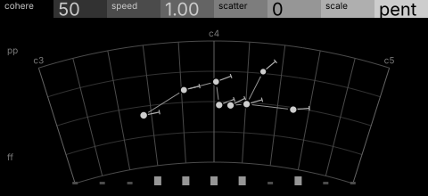
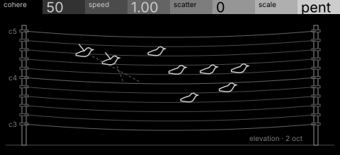

# flock · shortlist

A flock over a pitch field: birds play the pitch under them; cohesion clusters notes, speed sets density. Controls: cohere, speed, scatter, scale.

I looked at all five rest sketches at 1:1 and shortlisted two. This is a shortlist, not a pick: the pass stays open (`ready_for_pick`) until the owner chooses with `design_pass_select`.

## 1. v1 · P5 Field and figure, star atlas

The pitch field as an atlas sheet with the flock as one asterism: the machine's own picture.

## 2. v5 · P11 Instrument stack, orthographic elevation

Birds on wires that read as a staff: the most immediate image. A P11 stretch, with some icon risk to manage.

## The other three

v2 (P12, engineering schematic), v3 (P13, oscilloscope trace), v4 (P14, typeset diagram): see `notes.md` for what each one is and why it ranked lower.
