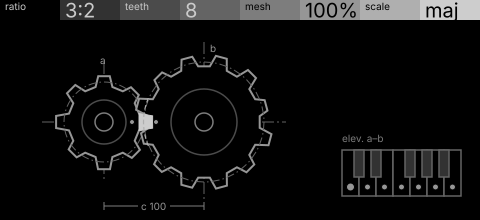
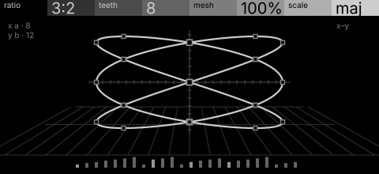

# gears · shortlist

Interlocking gears: each tooth that meshes plays a note, ratios between wheels make polyrhythms. Controls: ratio, teeth, mesh, scale.

I looked at all five rest sketches at 1:1 and shortlisted two. This is a shortlist, not a pick: the pass stays open (`ready_for_pick`) until the owner chooses with `design_pass_select`.

## 1. v4 · P13 Capture, orthographic elevation

Two spur gears in elevation, a tooth playing only when it reaches across the gap, with a small keyboard for the scale: the rule is the drawing. Note the header shows '%' on mesh, which needs dropping.

## 2. v2 · P5 Field and figure, oscilloscope trace

The two wheels' rates traced as one Lissajous figure on a scope: a striking picture of the polyrhythm, though no gear appears.

## The other three

v1 (P14, engineering schematic), v3 (P12, typeset diagram), v5 (P9, survey plan): see `notes.md` for what each one is and why it ranked lower.
