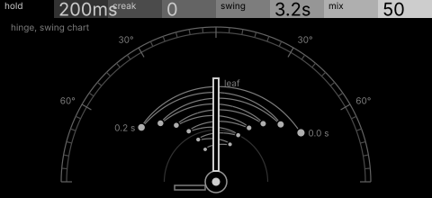
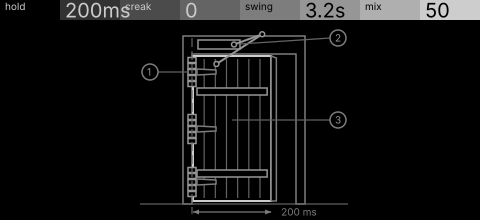

# hinge · shortlist

A swinging-door freeze: the door catches a slice of sound and swings it back and forth, creaking as it slows. Controls: hold, creak, swing, mix.

I looked at all five rest sketches at 1:1 and shortlisted two. This is a shortlist, not a pick: the pass stays open (`ready_for_pick`) until the owner chooses with `design_pass_select`.

## 1. v4 · P1 Section drawing, star atlas

The hinge at the pole of a swing chart, the swing spiralling in to rest as stars: the only variant that draws the swing dying away.

## 2. v5 · P11 Instrument stack, engineering schematic

A door in elevation with three hinges and a closer: unmistakably a door, each part a control a player would guess.

## The other three

v1 (P4, survey plan), v2 (P10, patent section), v3 (P15, hidden-line isometric): see `notes.md` for what each one is and why it ranked lower.
