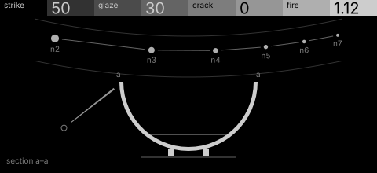
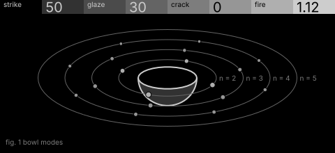

# kiln · shortlist

Modal synthesis of fired ceramic: a struck bowl whose glaze damps it and whose cracks make it inharmonic. Controls: strike, glaze, crack, fire.

I looked at all five rest sketches at 1:1 and shortlisted two. This is a shortlist, not a pick: the pass stays open (`ready_for_pick`) until the owner chooses with `design_pass_select`.

## 1. v2 · P1 Section drawing, star atlas

The bowl cut a–a under a star-atlas arc of modes: one bright object, unmistakable at 1:1, and the cheapest build (9 nodes).

## 2. v5 · P12 Orrery, typeset diagram

The bowl at the centre of its own mode orbits: standing waves round the rim drawn as an orrery, physically true and handsome. Static between notes.

## The other three

v1 (P15, hidden-line isometric), v3 (P2, engineering schematic), v4 (P3, oscilloscope trace): see `notes.md` for what each one is and why it ranked lower.
