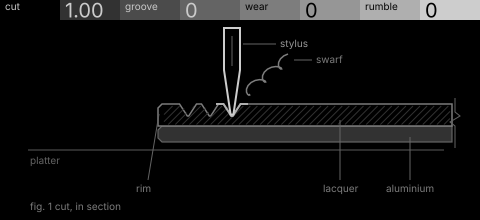
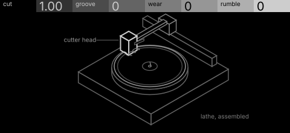

# lathe · shortlist

A record-cutting lathe: the signal is cut into a groove, saturating at the cutter, with wear and rumble on playback. Controls: cut, groove, wear, rumble.

I looked at all five rest sketches at 1:1 and shortlisted two. This is a shortlist, not a pick: the pass stays open (`ready_for_pick`) until the owner chooses with `design_pass_select`.

## 1. v1 · P1 Section drawing, typeset diagram

The cut in typeset section: stylus, swarf, lacquer and platter, labelled like a manual figure. Beautiful at 1:1.

## 2. v5 · P11 Instrument stack, hidden-line isometric

The lathe assembled in hidden-line isometric: the machine everyone can name, every control a part of it.

## The other three

v2 (P2, orthographic elevation), v3 (P3, survey plan), v4 (P4, patent section): see `notes.md` for what each one is and why it ranked lower.
