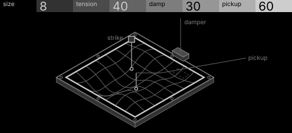
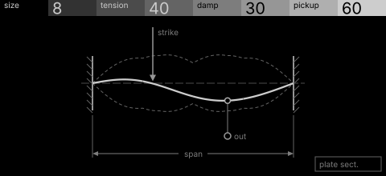

# lattice · shortlist

A 2D waveguide plate: a metal sheet held at its edges, excited at one point and heard at another. Controls: size, tension, damp, pickup.

I looked at all five rest sketches at 1:1 and shortlisted two. This is a shortlist, not a pick: the pass stays open (`ready_for_pick`) until the owner chooses with `design_pass_select`.

## 1. v2 · P1 Section drawing, hidden-line isometric

The bolted plate in hidden-line isometric, bent into its standing wave, with striker, pickup and felt damper. Reads at once as 'struck here, heard there'.

## 2. v4 · P3 Trace as subject, engineering schematic

The plate in section as one calm span between clamps, strike and pickup marked: the simplest, quietest picture of the set.

## The other three

v1 (P15, patent section), v3 (P2, star atlas), v5 (P12, oscilloscope trace): see `notes.md` for what each one is and why it ranked lower.
