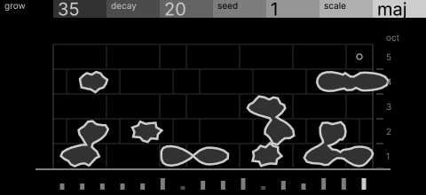
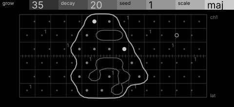

# lichen · shortlist

A growth automaton on a scale lattice: cells grow into neighbours and decay; new growth plays. Controls: grow, decay, seed, scale.

I looked at all five rest sketches at 1:1 and shortlisted two. This is a shortlist, not a pick: the pass stays open (`ready_for_pick`) until the owner chooses with `design_pass_select`.

## 1. v4 · P5 Field and figure, orthographic elevation

A lichen patch on a running-bond wall in elevation (running bond has the same neighbours as the machine's hex lattice): bright growth margin, cracked dead centre, no legend needed.

## 2. v2 · P13 Capture, oscilloscope trace

The lattice as a graticule of dots, the growth front one bright closed trace and the dead centre a dim one inside it: the rule itself, very clean at 1:1.

## The other three

v1 (P12, engineering schematic), v3 (P14, typeset diagram), v5 (P2, survey plan): see `notes.md` for what each one is and why it ranked lower.
