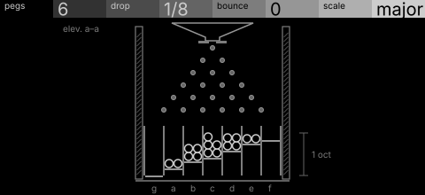
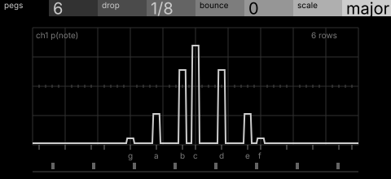

# marble · shortlist

A Galton board: marbles drop through pegs into pitched bins; peg spacing shapes the distribution of notes. Controls: pegs, drop, bounce, scale.

I looked at all five rest sketches at 1:1 and shortlisted two. This is a shortlist, not a pick: the pass stays open (`ready_for_pick`) until the owner chooses with `design_pass_select`.

## 1. v4 · P13 Capture, orthographic elevation

The Galton board in elevation, bins cut to their notes and the caught marbles piling up: nothing to learn.

## 2. v2 · P5 Field and figure, oscilloscope trace

The odds as one bright stepped trace on a graticule: the clearest at 1:1, but the board itself never appears.

## The other three

v1 (P14, engineering schematic), v3 (P12, typeset diagram), v5 (P3, survey plan): see `notes.md` for what each one is and why it ranked lower.
