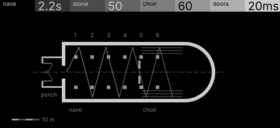
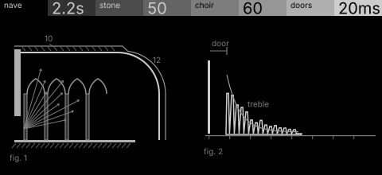

# nave · shortlist

A reverb modelled on a stone nave: its length, stone hardness, the choir's diffusion and the doors' pre-delay. Controls: nave, stone, choir, doors.

I looked at all five rest sketches at 1:1 and shortlisted two. This is a shortlist, not a pick: the pass stays open (`ready_for_pick`) until the owner chooses with `design_pass_select`.

## 1. v1 · P1 Section drawing, survey plan

The church in survey plan, a sound ray bouncing down the bays: the building itself, calm and authored.

## 2. v2 · P2 Diagram + trace, patent section

The nave in long section beside its impulse response: the truest picture of the DSP. Two figures, so it reads more like a document.

## The other three

v3 (P3, hidden-line isometric), v4 (P4, star atlas), v5 (P9, engineering schematic): see `notes.md` for what each one is and why it ranked lower.
