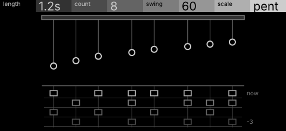
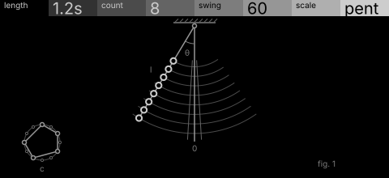

# pendula · shortlist

A pendulum wave: pendulums of slowly different lengths each play a note as they cross the centre, drifting in and out of phase. Controls: length, count, swing, scale.

I looked at all five rest sketches at 1:1 and shortlisted two. This is a shortlist, not a pick: the pass stays open (`ready_for_pick`) until the owner chooses with `design_pass_select`.

## 1. v2 · P14 Loom, orthographic elevation

The pendulum-wave apparatus face on, its strings running down into a loom of the last four beats: the only picture of the phase drift as history.

## 2. v1 · P13 Capture, typeset diagram

Every pendulum on one pivot with nested swing arcs and the plumb line as the gate: the calmest, clearest picture of the rule.

## The other three

v3 (P5, survey plan), v4 (P12, patent section), v5 (P6, hidden-line isometric): see `notes.md` for what each one is and why it ranked lower.
