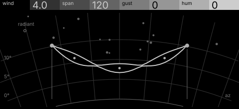
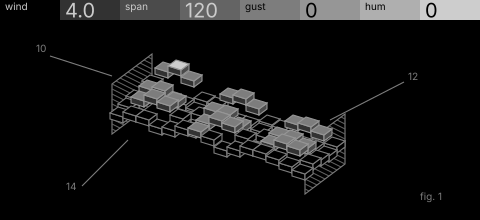

# pylon · shortlist

An aeolian harp: power lines sung by wind, the span and gusts setting which modes speak, with a mains hum under it. Controls: wind, span, gust, hum.

I looked at all five rest sketches at 1:1 and shortlisted two. This is a shortlist, not a pick: the pass stays open (`ready_for_pick`) until the owner chooses with `design_pass_select`.

## 1. v3 · P1 Section drawing, star atlas

The singing wire as standing-wave loops on its catenary between two pylon stars: one bright subject and a lot of sky.

## 2. v1 · P10 Voice field, patent section

Conductors as rows of hidden-line slabs whose heights are the locked wave, with hatched cross-arms: the most faithful mapping, but close to toro and heavy on nodes.

## The other three

v2 (P15, hidden-line isometric), v4 (P2, engineering schematic), v5 (P14, oscilloscope trace): see `notes.md` for what each one is and why it ranked lower.
