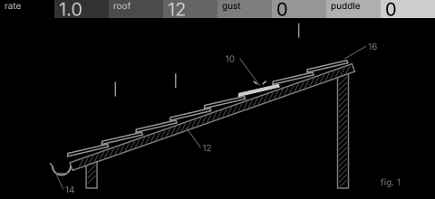
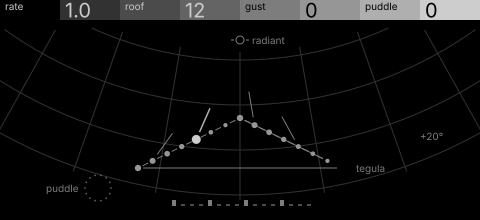

# rain · shortlist

Raindrops on a roof of pitched tiles: drops fall at a rate, gusts push them across, puddles repeat the last notes. Controls: rate, roof, gust, puddle.

I looked at all five rest sketches at 1:1 and shortlisted two. This is a shortlist, not a pick: the pass stays open (`ready_for_pick`) until the owner chooses with `design_pass_select`.

## 1. v2 · P13 Capture, patent section

A pitched roof in patent section with drops landing on its tiles: the machine's own picture, quiet and clear.

## 2. v4 · P5 Field and figure, star atlas

Drops as meteors from a radiant onto a roof-line constellation: every control has its own part at rest.

## The other three

v1 (P12, survey plan), v3 (P14, hidden-line isometric), v5 (P9, engineering schematic): see `notes.md` for what each one is and why it ranked lower.
