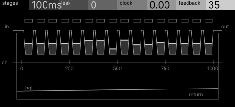
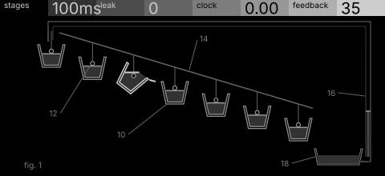

# relay · shortlist

A bucket-brigade delay with failing stages: some buckets leak, the clock wanders, feedback recirculates. Controls: stages, leak, clock, feedback.

I looked at all five rest sketches at 1:1 and shortlisted two. This is a shortlist, not a pick: the pass stays open (`ready_for_pick`) until the owner chooses with `design_pass_select`.

## 1. v4 · P1 Section drawing, survey plan

The charge channel cut open lengthwise, a pool in each well, gates and a chainage: the most specific to this machine.

## 2. v5 · P11 Instrument stack, patent section

A literal bucket brigade in patent section, one bucket tipping: charming and immediately readable, a P11 stretch that leans on the name.

## The other three

v1 (P4, oscilloscope trace), v2 (P10, typeset diagram), v3 (P15, orthographic elevation): see `notes.md` for what each one is and why it ranked lower.
