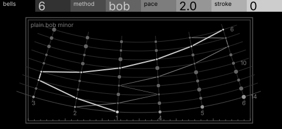
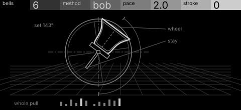

# ringer · shortlist

Change ringing: a set of bells permuted by a method, one change per row, at a steady pace. Controls: bells, method, pace, stroke.

I looked at all five rest sketches at 1:1 and shortlisted two. This is a shortlist, not a pick: the pass stays open (`ready_for_pick`) until the owner chooses with `design_pass_select`.

## 1. v3 · P14 Loom, star atlas

Changes as parallels of a conic star chart, the treble's path the bright constellation line: the method's shape reads at a glance, and the atlas furniture keeps it a chart, not a grid. Rows sliding back cost too many nodes, so it needs a fixed chart with a moving 'now' row.

## 2. v4 · P5 Field and figure, engineering schematic

One bell set on its wheel and stay, the whole pull in a strip below: the strongest single object. It carries only pace, so the frames pass has to give the method a real part.

## The other three

v1 (P12, patent section), v2 (P13, hidden-line isometric), v5 (P4, oscilloscope trace): see `notes.md` for what each one is and why it ranked lower.
