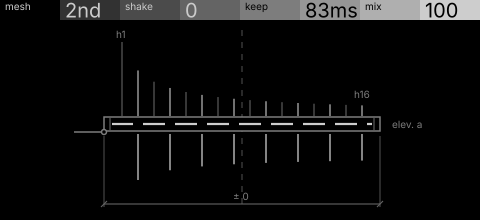
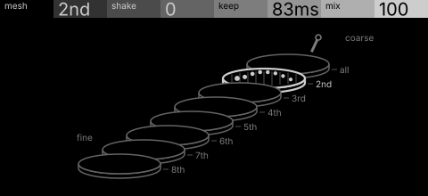

# sieve · shortlist

A harmonic sieve: a comb filter tuned to the input's fundamental keeps only chosen multiples, shaken to let others through. Controls: mesh, shake, keep, mix.

I looked at all five rest sketches at 1:1 and shortlisted two. This is a shortlist, not a pick: the pass stays open (`ready_for_pick`) until the owner chooses with `design_pass_select`.

## 1. v1 · P1 Section drawing, orthographic elevation

Harmonics fall as rods through a riddle's mesh, and only those over a hole pass: the machine's rule is the drawing.

## 2. v4 · P4 Stack in depth, hidden-line isometric

A stack of sieves from coarse to fine with the chosen one lit: clear and calm. Eight trays is past P4's usual cap.

## The other three

v2 (P2, survey plan), v3 (P3, patent section), v5 (P11, star atlas): see `notes.md` for what each one is and why it ranked lower.
