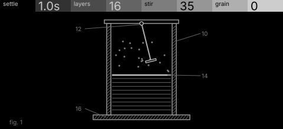
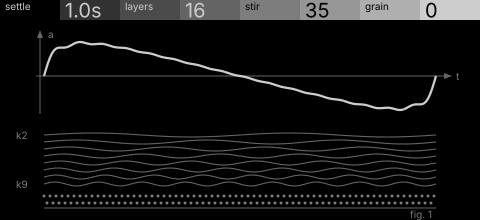

# silt · shortlist

Additive partials that settle like sediment: stirring lifts the high partials, which then sink back at a settling rate. Controls: settle, layers, stir, grain.

I looked at all five rest sketches at 1:1 and shortlisted two. This is a shortlist, not a pick: the pass stays open (`ready_for_pick`) until the owner chooses with `design_pass_select`.

## 1. v5 · P11 Instrument stack, patent section

A settling column in patent section, stirrer above, layers below: instantly 'sediment'. A P11 stretch that works as a section drawing.

## 2. v2 · P3 Trace as subject, typeset diagram

The stirred wave printed large with its partials hanging below and sinking to a stippled bed: the calmest and most finished.

## The other three

v1 (P2, oscilloscope trace), v3 (P4, orthographic elevation), v4 (P5, survey plan): see `notes.md` for what each one is and why it ranked lower.
