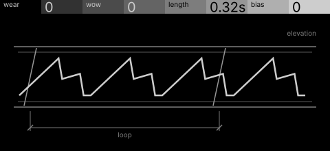
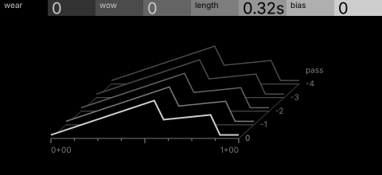

# spool · shortlist

A single-cycle wave written onto a short tape loop that wears with every pass; bias and wow colour it. Controls: wear, wow, length, bias.

I looked at all five rest sketches at 1:1 and shortlisted two. This is a shortlist, not a pick: the pass stays open (`ready_for_pick`) until the owner chooses with `design_pass_select`.

## 1. v2 · P3 Trace as subject, orthographic elevation

The written cycle repeated along a strip of tape with splices and a loop dimension: reads instantly, each control owns a part.

## 2. v3 · P4 Stack in depth, survey plan

Passes stacked back in a survey plan, the newest bright: wear becomes visible history. Only shows its point once wear is up.

## The other three

v1 (P2, typeset diagram), v4 (P5, patent section), v5 (P14, hidden-line isometric): see `notes.md` for what each one is and why it ranked lower.
