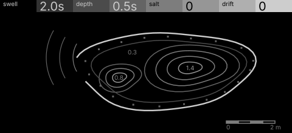
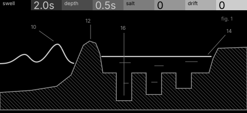

# tide · shortlist

A bank of tuned resonators in a rock pool, excited by noise that arrives in waves; notes set the pool's tuning. Controls: swell, depth, salt, drift.

I looked at all five rest sketches at 1:1 and shortlisted two. This is a shortlist, not a pick: the pass stays open (`ready_for_pick`) until the owner chooses with `design_pass_select`.

## 1. v4 · P1 Section drawing, survey plan

A rock pool in survey plan: one bright rim open to the sea, contours, swell fronts at the mouth. Calm, mostly black, and every control owns a separate thing.

## 2. v5 · P13 Capture, patent section

The pool in patent section: waves over the rim into three chambers that ring at their own depths. The clearest picture of how it works; busier, and its P13 stretch is half a P1.

## The other three

v1 (P5, oscilloscope trace), v2 (P10, typeset diagram), v3 (P15, orthographic elevation): see `notes.md` for what each one is and why it ranked lower.
