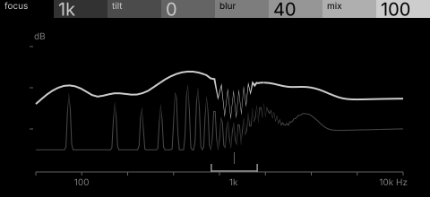
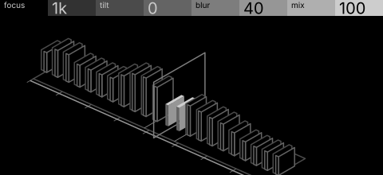

# tilt · shortlist

Tilt-shift for sound: a spectral tilt with a blur that smears everything outside a focal band. Controls: focus, tilt, blur, mix.

I looked at all five rest sketches at 1:1 and shortlisted two. This is a shortlist, not a pick: the pass stays open (`ready_for_pick`) until the owner chooses with `design_pass_select`.

## 1. v1 · P3 Trace as subject, typeset diagram

One bright spectrum line on a labelled log-frequency axis, jagged inside the focal band and smooth outside: reads instantly and is the cheapest build.

## 2. v5 · P13 Capture, hidden-line isometric

A row of frequency cards in hidden-line isometric with a plane of focus cutting through: the tilt-shift idea itself. Only focus and blur have a real twin in the optics.

## The other three

v2 (P4, orthographic elevation), v3 (P10, survey plan), v4 (P15, patent section): see `notes.md` for what each one is and why it ranked lower.
