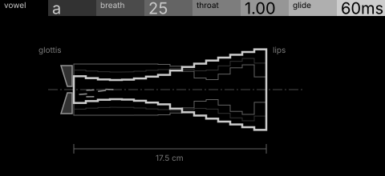
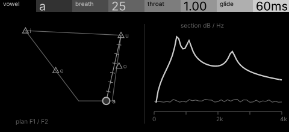

# vapor · shortlist

A breathy formant voice: a glottal pulse through a throat tube and vowel formants, gliding between vowels. Controls: vowel, breath, throat, glide.

I looked at all five rest sketches at 1:1 and shortlisted two. This is a shortlist, not a pick: the pass stays open (`ready_for_pick`) until the owner chooses with `design_pass_select`.

## 1. v2 · P1 Section drawing, orthographic elevation

The vocal tract in elevation from glottis to lips, its stepped profile a vowel: the sound's own mechanism as one subject.

## 2. v3 · P2 Diagram + trace, survey plan

The vowel as a point on an F1/F2 plan beside its formant section: explains vowel and glide plainly. Two figures, so it reads more like a document.

## The other three

v1 (P15, typeset diagram), v4 (P3, patent section), v5 (P11, hidden-line isometric): see `notes.md` for what each one is and why it ranked lower.
